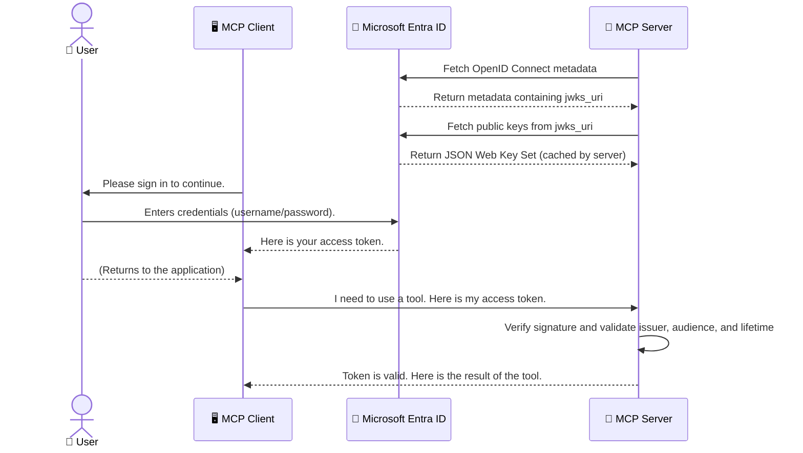

# Bảo Mật Quy Trình AI: Xác Thực Entra ID cho Máy Chủ Giao Thức Ngữ Cảnh Mô Hình

> [!NOTE]
> Mã máy chủ từ xa trong bài học này bảo vệ các điểm cuối `/sse` và `/message` cũ
> và nhắm tới MCP `2025-11-25`. Giữ các thực hành xác thực danh tính và kiểm tra token,
> nhưng sử dụng giao thức HTTP Streamable tương thích với `2026-07-28` cho các triển khai mới.


## Giới thiệu
Bảo mật máy chủ Giao Thức Ngữ Cảnh Mô Hình (MCP) của bạn quan trọng như việc khóa cửa chính ngôi nhà của bạn. Việc để máy chủ MCP mở exposes công cụ và dữ liệu của bạn cho truy cập trái phép, có thể dẫn đến các lỗ hổng bảo mật. Microsoft Entra ID cung cấp giải pháp quản lý danh tính và truy cập dựa trên đám mây mạnh mẽ, giúp đảm bảo rằng chỉ người dùng và ứng dụng được ủy quyền mới có thể tương tác với máy chủ MCP của bạn. Trong phần này, bạn sẽ học cách bảo vệ quy trình AI của mình bằng cách sử dụng xác thực Entra ID.

## Mục tiêu học tập
Đến cuối phần này, bạn sẽ có thể:

- Hiểu được tầm quan trọng của việc bảo mật máy chủ MCP.
- Giải thích các kiến thức cơ bản về Microsoft Entra ID và xác thực OAuth 2.0.
- Nhận biết sự khác biệt giữa client công khai và client bí mật.
- Thực hiện xác thực Entra ID trong cả kịch bản máy chủ MCP cục bộ (client công khai) và từ xa (client bí mật).
- Áp dụng các thực hành bảo mật tốt nhất khi phát triển quy trình AI.

## Bảo mật và MCP

Cũng như bạn không để cửa chính nhà mở không khóa, bạn không nên để máy chủ MCP của mình mở cho bất kỳ ai truy cập. Bảo mật quy trình AI của bạn là điều cần thiết để xây dựng các ứng dụng mạnh mẽ, đáng tin cậy và an toàn. Chương này sẽ giới thiệu cho bạn cách sử dụng Microsoft Entra ID để bảo mật máy chủ MCP, đảm bảo chỉ người dùng và ứng dụng được phép mới có thể tương tác với công cụ và dữ liệu của bạn.

## Tại sao bảo mật quan trọng cho máy chủ MCP

Hãy tưởng tượng máy chủ MCP của bạn có một công cụ có thể gửi email hoặc truy cập cơ sở dữ liệu khách hàng. Một máy chủ không được bảo mật có nghĩa là bất kỳ ai cũng có thể sử dụng công cụ đó, dẫn đến truy cập dữ liệu trái phép, thư rác hoặc các hoạt động độc hại khác.

Bằng cách triển khai xác thực, bạn đảm bảo rằng mọi yêu cầu đến máy chủ đều được xác minh, xác nhận danh tính người dùng hoặc ứng dụng thực hiện yêu cầu. Đây là bước đầu tiên và quan trọng nhất trong việc bảo mật quy trình AI của bạn.

## Giới thiệu về Microsoft Entra ID

[**Microsoft Entra ID**](https://adoption.microsoft.com/microsoft-security/entra/) là dịch vụ quản lý danh tính và truy cập dựa trên đám mây. Hãy tưởng tượng nó như một nhân viên bảo vệ an ninh toàn cầu cho ứng dụng của bạn. Nó xử lý quy trình phức tạp của việc xác minh danh tính người dùng (xác thực) và xác định họ được phép làm gì (ủy quyền).

Bằng cách sử dụng Entra ID, bạn có thể:

- Kích hoạt đăng nhập an toàn cho người dùng.
- Bảo vệ các API và dịch vụ.
- Quản lý chính sách truy cập từ một vị trí trung tâm.

Đối với máy chủ MCP, Entra ID cung cấp một giải pháp mạnh mẽ và được tin cậy rộng rãi để quản lý ai có thể truy cập các khả năng của máy chủ bạn.

---

## Hiểu về Ma thuật: Cách Xác Thực Entra ID Hoạt Động

Entra ID sử dụng các tiêu chuẩn mở như **OAuth 2.0** để xử lý xác thực. Mặc dù chi tiết có thể phức tạp, nguyên tắc cốt lõi rất đơn giản và có thể hiểu qua một phép ẩn dụ.

### Giới thiệu Nhẹ nhàng về OAuth 2.0: Chìa Khóa Đỗ Xe

Hãy tưởng tượng OAuth 2.0 như một dịch vụ đỗ xe xe của bạn. Khi bạn tới nhà hàng, bạn không đưa cho người giữ xe chìa khóa chính của bạn. Thay vào đó, bạn cung cấp một **chìa khóa đỗ xe** có quyền hạn giới hạn — nó có thể khởi động xe và khóa cửa, nhưng không thể mở cốp hoặc ngăn đựng đồ.

Trong phép ẩn dụ này:

- **Bạn** là **Người dùng**.
- **Chiếc xe của bạn** là **Máy chủ MCP** với các công cụ và dữ liệu giá trị.
- **Người giữ xe** là **Microsoft Entra ID**.
- **Nhân viên giữ xe** là **Client MCP** (ứng dụng cố gắng truy cập máy chủ).
- **Chìa khóa đỗ xe** là **Access Token**.

Access token là một chuỗi văn bản bảo mật mà client MCP nhận được từ Entra ID sau khi bạn đăng nhập. Client sẽ trình token này với máy chủ MCP mỗi khi gửi yêu cầu. Máy chủ có thể xác minh token để đảm bảo yêu cầu hợp lệ và client có quyền hạn cần thiết, mà không cần phải xử lý thông tin đăng nhập thực của bạn (như mật khẩu).

### Luồng Xác Thực

Đây là cách quy trình hoạt động trong thực tế:



Máy chủ MCP không gọi Entra ID để xác thực từng access token. Nó
xác minh chữ ký JWT một cách mật mã với khóa công khai đã lưu cache của Entra ID
và kiểm tra các claims của token, bao gồm nhà phát hành, đối tượng và thời gian hiệu lực.
Máy chủ đọc `jwks_uri` từ metadata OpenID Connect, lấy các khóa công khai
từ URI đó và làm mới chúng định kỳ để xử lý việc xoay khóa. Sử dụng
thư viện xác thực token được hỗ trợ thay vì tự triển khai logic này.
Chi tiết xem tại
[Validate tokens in the Microsoft identity platform](https://learn.microsoft.com/entra/identity-platform/access-tokens#validate-tokens).

### Giới thiệu Thư Viện Xác Thực Microsoft (MSAL)

Trước khi chúng ta vào mã, quan trọng là giới thiệu một thành phần chủ chốt bạn sẽ thấy trong ví dụ: **Microsoft Authentication Library (MSAL)**.

MSAL là một thư viện do Microsoft phát triển giúp lập trình viên dễ dàng hơn trong việc xử lý xác thực. Thay vì bạn phải viết tất cả mã phức tạp xử lý token bảo mật, quản lý đăng nhập và làm mới phiên, MSAL lo phần lớn công việc nặng nhọc.

Sử dụng thư viện như MSAL được khuyến nghị cao vì:

- **Nó An Toàn:** Thực thi các giao thức tiêu chuẩn ngành và thực hành bảo mật tốt nhất, giảm rủi ro lỗ hổng trong mã của bạn.
- **Nó Đơn Giản Hóa Việc Phát Triển:** Trừu tượng hóa sự phức tạp của các giao thức OAuth 2.0 và OpenID Connect, cho phép bạn thêm xác thực chắc chắn vào ứng dụng chỉ với vài dòng mã.
- **Được Bảo Trì:** Microsoft chủ động duy trì và cập nhật MSAL để giải quyết các mối đe dọa bảo mật mới và thay đổi nền tảng.

MSAL hỗ trợ nhiều ngôn ngữ và framework ứng dụng, bao gồm .NET, JavaScript/TypeScript, Python, Java, Go, và các nền tảng di động như iOS và Android. Điều này có nghĩa là bạn có thể sử dụng các mẫu xác thực nhất quán trên toàn bộ ngăn xếp công nghệ của mình.

Để tìm hiểu thêm về MSAL, bạn có thể xem tài liệu chính thức [MSAL overview documentation](https://learn.microsoft.com/entra/identity-platform/msal-overview).

---

## Bảo Mật Máy Chủ MCP của Bạn với Entra ID: Hướng Dẫn Từng Bước

Bây giờ, hãy cùng xem cách bảo mật một máy chủ MCP cục bộ (một máy giao tiếp qua `stdio`) bằng Entra ID. Ví dụ này sử dụng **client công khai**, phù hợp với các ứng dụng chạy trên máy người dùng, như ứng dụng desktop hoặc máy chủ phát triển cục bộ.

### Kịch Bản 1: Bảo Mật Máy Chủ MCP Cục Bộ (với Client Công Khai)

Trong kịch bản này, chúng ta sẽ xem một máy chủ MCP chạy cục bộ, giao tiếp qua `stdio`, và sử dụng Entra ID để xác thực người dùng trước khi cho phép truy cập công cụ của nó. Máy chủ sẽ có một công cụ duy nhất lấy thông tin hồ sơ người dùng từ Microsoft Graph API.

#### 1. Thiết Lập Ứng Dụng trong Entra ID

Trước khi viết mã, bạn cần đăng ký ứng dụng của mình trong Microsoft Entra ID. Điều này cho Entra ID biết về ứng dụng của bạn và cấp quyền sử dụng dịch vụ xác thực.

1. Điều hướng đến **[cổng Microsoft Entra](https://entra.microsoft.com/)**.
2. Vào **Đăng ký ứng dụng** và nhấn **Đăng ký mới**.
3. Đặt tên cho ứng dụng của bạn (ví dụ: "Máy chủ MCP cục bộ của tôi").
4. Trong **Loại tài khoản được hỗ trợ**, chọn **Chỉ tài khoản trong thư mục tổ chức này**.
5. Bạn có thể để trống **URI chuyển hướng** trong ví dụ này.
6. Nhấn **Đăng ký**.

Sau khi đăng ký, ghi lại **Mã ứng dụng (client) ID** và **Mã thư mục (tenant) ID**. Bạn sẽ cần chúng trong mã của mình.

#### 2. Mã ví dụ: Phân tích

Hãy xem các phần chính trong mã xử lý xác thực. Mã đầy đủ cho ví dụ này có trong thư mục [Entra ID - Local - WAM](https://github.com/Azure-Samples/mcp-auth-servers/tree/main/src/entra-id-local-wam) của [kho GitHub mcp-auth-servers](https://github.com/Azure-Samples/mcp-auth-servers).

**`AuthenticationService.cs`**

Lớp này chịu trách nhiệm xử lý việc tương tác với Entra ID.

- **`CreateAsync`**: Phương thức này khởi tạo `PublicClientApplication` từ MSAL (Microsoft Authentication Library). Nó được cấu hình với `clientId` và `tenantId` của ứng dụng bạn.
- **`WithBroker`**: Kích hoạt sử dụng broker (như Windows Web Account Manager), cung cấp trải nghiệm đăng nhập một lần an toàn và liền mạch hơn.
- **`AcquireTokenAsync`**: Đây là phương thức cốt lõi. Nó cố lấy token một cách im lặng (nghĩa là người dùng không cần đăng nhập lại nếu đã có phiên hợp lệ). Nếu không lấy được token im lặng, nó sẽ hiện giao diện để người dùng đăng nhập tương tác.

```csharp
// Simplified for clarity
public static async Task<AuthenticationService> CreateAsync(ILogger<AuthenticationService> logger)
{
    var msalClient = PublicClientApplicationBuilder
        .Create(_clientId) // Your Application (client) ID
        .WithAuthority(AadAuthorityAudience.AzureAdMyOrg)
        .WithTenantId(_tenantId) // Your Directory (tenant) ID
        .WithBroker(new BrokerOptions(BrokerOptions.OperatingSystems.Windows))
        .Build();

    // ... cache registration ...

    return new AuthenticationService(logger, msalClient);
}

public async Task<string> AcquireTokenAsync()
{
    try
    {
        // Try silent authentication first
        var accounts = await _msalClient.GetAccountsAsync();
        var account = accounts.FirstOrDefault();

        AuthenticationResult? result = null;

        if (account != null)
        {
            result = await _msalClient.AcquireTokenSilent(_scopes, account).ExecuteAsync();
        }
        else
        {
            // If no account, or silent fails, go interactive
            result = await _msalClient.AcquireTokenInteractive(_scopes).ExecuteAsync();
        }

        return result.AccessToken;
    }
    catch (Exception ex)
    {
        _logger.LogError(ex, "An error occurred while acquiring the token.");
        throw; // Optionally rethrow the exception for higher-level handling
    }
}
```

**`Program.cs`**

Đây là nơi thiết lập máy chủ MCP và tích hợp dịch vụ xác thực.

- **`AddSingleton<AuthenticationService>`**: Đăng ký `AuthenticationService` với container tiêm phụ thuộc để sử dụng trong các phần khác của ứng dụng (như công cụ của chúng ta).
- **`GetUserDetailsFromGraph` tool**: Công cụ này cần một thể hiện `AuthenticationService`. Trước khi làm gì, nó gọi `authService.AcquireTokenAsync()` để lấy token truy cập hợp lệ. Nếu xác thực thành công, nó dùng token gọi API Microsoft Graph để lấy chi tiết người dùng.

```csharp
// Simplified for clarity
[McpServerTool(Name = "GetUserDetailsFromGraph")]
public static async Task<string> GetUserDetailsFromGraph(
    AuthenticationService authService)
{
    try
    {
        // This will trigger the authentication flow
        var accessToken = await authService.AcquireTokenAsync();

        // Use the token to create a GraphServiceClient
        var graphClient = new GraphServiceClient(
            new BaseBearerTokenAuthenticationProvider(new TokenProvider(authService)));

        var user = await graphClient.Me.GetAsync();

        return System.Text.Json.JsonSerializer.Serialize(user);
    }
    catch (Exception ex)
    {
        return $"Error: {ex.Message}";
    }
}
```

#### 3. Cách Các Thành Phần Hoạt Động Cùng Nhau

1. Khi client MCP cố dùng công cụ `GetUserDetailsFromGraph`, công cụ trước tiên gọi `AcquireTokenAsync`.
2. `AcquireTokenAsync` kích hoạt thư viện MSAL kiểm tra token hợp lệ.
3. Nếu không có token, MSAL thông qua broker sẽ yêu cầu người dùng đăng nhập bằng tài khoản Entra ID.
4. Sau khi người dùng đăng nhập, Entra ID phát hành access token.
5. Công cụ nhận token và sử dụng nó để gọi an toàn API Microsoft Graph.
6. Chi tiết người dùng được trả về cho client MCP.

Quy trình này đảm bảo chỉ người dùng đã xác thực mới dùng được công cụ, bảo mật hiệu quả máy chủ MCP cục bộ của bạn.

### Kịch Bản 2: Bảo Mật Máy Chủ MCP Từ Xa (với Client Bí Mật)

Khi máy chủ MCP của bạn chạy trên máy từ xa (như máy chủ đám mây) và giao tiếp qua giao thức như HTTP Streaming, yêu cầu bảo mật sẽ khác. Trong trường hợp này, bạn nên sử dụng **client bí mật** và **Authorization Code Flow**. Đây là phương thức an toàn hơn vì bí mật ứng dụng không bao giờ bị lộ ra trình duyệt.

Ví dụ này sử dụng máy chủ MCP viết bằng TypeScript, dùng Express.js để xử lý các yêu cầu HTTP.

#### 1. Thiết Lập Ứng Dụng trong Entra ID

Việc thiết lập trong Entra ID tương tự client công khai, nhưng có một điểm khác: bạn cần tạo **client secret**.

1. Điều hướng đến **[cổng Microsoft Entra](https://entra.microsoft.com/)**.
2. Trong đăng ký ứng dụng của bạn, vào tab **Certificates & secrets**.
3. Nhấn **New client secret**, mô tả, rồi nhấn **Add**.
4. **Quan trọng:** Sao chép ngay giá trị secret. Bạn sẽ không thể nhìn thấy nó lần nữa.
5. Bạn cũng cần cấu hình **Redirect URI**. Vào tab **Authentication**, nhấn **Add a platform**, chọn **Web**, và nhập URI chuyển hướng của ứng dụng bạn (ví dụ, `http://localhost:3001/auth/callback`).

> **⚠️ Lưu ý bảo mật quan trọng:** Đối với ứng dụng sản xuất, Microsoft khuyến nghị mạnh mẽ sử dụng các phương pháp **xác thực không cần bí mật** như **Managed Identity** hoặc **Workload Identity Federation** thay vì client secret. Client secret tiềm ẩn rủi ro bảo mật do có thể bị lộ hoặc đánh cắp. Managed identity cung cấp cách tiếp cận an toàn hơn bằng cách không lưu thông tin đăng nhập trong mã hoặc cấu hình của bạn.
>
> Để biết thêm thông tin về managed identities và cách triển khai, xem [Tổng quan về Managed identities cho tài nguyên Azure](https://learn.microsoft.com/entra/identity/managed-identities-azure-resources/overview).

#### 2. Mã ví dụ: Phân tích

Ví dụ này dùng cách tiếp cận dựa trên session. Khi người dùng xác thực, máy chủ lưu access token và refresh token trong session và cấp cho người dùng một session token. Token session này sau đó được dùng cho các yêu cầu kế tiếp. Mã đầy đủ cho ví dụ này có trong thư mục [Entra ID - Confidential client](https://github.com/Azure-Samples/mcp-auth-servers/tree/main/src/entra-id-cca-session) của [kho GitHub mcp-auth-servers](https://github.com/Azure-Samples/mcp-auth-servers).

**`Server.ts`**

Tệp này thiết lập máy chủ Express và lớp giao thức MCP.

- **`requireBearerAuth`**: Middleware bảo vệ các điểm cuối `/sse` và `/message`. Nó kiểm tra token bearer hợp lệ trong header `Authorization` của yêu cầu.
- **`EntraIdServerAuthProvider`**: Một lớp tùy chỉnh triển khai giao diện `McpServerAuthorizationProvider`. Chịu trách nhiệm xử lý luồng OAuth 2.0.
- **`/auth/callback`**: Điểm cuối này xử lý chuyển hướng từ Entra ID sau khi người dùng xác thực. Nó trao đổi mã ủy quyền lấy access token và refresh token.

```typescript
// Simplified for clarity
const app = express();
const { server } = createServer();
const provider = new EntraIdServerAuthProvider();

// Protect the SSE endpoint
app.get("/sse", requireBearerAuth({
  provider,
  requiredScopes: ["User.Read"]
}), async (req, res) => {
  // ... connect to the transport ...
});

// Protect the message endpoint
app.post("/message", requireBearerAuth({
  provider,
  requiredScopes: ["User.Read"]
}), async (req, res) => {
  // ... handle the message ...
});

// Handle the OAuth 2.0 callback
app.get("/auth/callback", (req, res) => {
  provider.handleCallback(req.query.code, req.query.state)
    .then(result => {
      // ... handle success or failure ...
    });
});
```

**`Tools.ts`**

Tệp này định nghĩa các công cụ mà máy chủ MCP cung cấp. Công cụ `getUserDetails` tương tự như công cụ trong ví dụ trước, nhưng nó lấy mã truy cập từ phiên làm việc.

```typescript
// Simplified for clarity
server.setRequestHandler(CallToolRequestSchema, async (request) => {
  const { name } = request.params;
  const context = request.params?.context as { token?: string } | undefined;
  const sessionToken = context?.token;

  if (name === ToolName.GET_USER_DETAILS) {
    if (!sessionToken) {
      throw new AuthenticationError("Authentication token is missing or invalid. Ensure the token is provided in the request context.");
    }

    // Get the Entra ID token from the session store
    const tokenData = tokenStore.getToken(sessionToken);
    const entraIdToken = tokenData.accessToken;

    const graphClient = Client.init({
      authProvider: (done) => {
        done(null, entraIdToken);
      }
    });

    const user = await graphClient.api('/me').get();

    // ... return user details ...
  }
});
```

**`auth/EntraIdServerAuthProvider.ts`**

Lớp này xử lý logic cho:

- Chuyển hướng người dùng đến trang đăng nhập Entra ID.
- Trao đổi mã ủy quyền lấy mã truy cập.
- Lưu trữ các mã trong `tokenStore`.
- Làm mới mã truy cập khi hết hạn.

#### 3. Cách Tất Cả Hoạt Động Cùng Nhau

1. Khi người dùng lần đầu cố gắng kết nối với máy chủ MCP, `requireBearerAuth` middleware sẽ phát hiện họ không có phiên hợp lệ và sẽ chuyển hướng họ đến trang đăng nhập Entra ID.
2. Người dùng đăng nhập bằng tài khoản Entra ID của họ.
3. Entra ID chuyển hướng người dùng trở lại điểm cuối `/auth/callback` với mã ủy quyền.
4. Máy chủ trao đổi mã lấy mã truy cập và mã làm mới, lưu trữ chúng và tạo mã phiên được gửi đến client.
5. Client bây giờ có thể sử dụng mã phiên này trong header `Authorization` cho tất cả các yêu cầu trong tương lai đến máy chủ MCP.
6. Khi công cụ `getUserDetails` được gọi, nó sử dụng mã phiên để tra cứu mã truy cập Entra ID rồi dùng mã đó gọi Microsoft Graph API.

Luồng này phức tạp hơn luồng client công khai, nhưng cần thiết cho các điểm cuối hướng internet. Vì các máy chủ MCP từ xa có thể truy cập qua internet công cộng, nên cần có các biện pháp bảo mật mạnh hơn để bảo vệ khỏi truy cập trái phép và các cuộc tấn công tiềm ẩn.


## Các Thực Hành Tốt Nhất Về Bảo Mật

- **Luôn sử dụng HTTPS**: Mã hóa giao tiếp giữa client và server để bảo vệ các mã khỏi bị đánh cắp.
- **Triển khai Kiểm Soát Truy Cập Theo Vai Trò (RBAC)**: Không chỉ kiểm tra *nếu* người dùng đã xác thực; mà còn kiểm tra *họ được phép làm gì*. Bạn có thể định nghĩa vai trò trong Entra ID và kiểm tra trong máy chủ MCP của bạn.
- **Giám sát và kiểm tra**: Ghi lại tất cả các sự kiện xác thực để phát hiện và phản ứng với các hoạt động đáng ngờ.
- **Xử lý giới hạn tần suất và hạn chế yêu cầu**: Microsoft Graph và các API khác thực hiện giới hạn tần suất để ngăn chặn lạm dụng. Triển khai thuật toán thụ hồi theo cấp số nhân và logic thử lại trong máy chủ MCP để xử lý mượt mà các phản hồi HTTP 429 (Quá nhiều yêu cầu). Cân nhắc bộ nhớ đệm dữ liệu truy cập thường xuyên để giảm số lần gọi API.
- **Lưu trữ mã an toàn**: Lưu trữ mã truy cập và mã làm mới một cách an toàn. Với ứng dụng cục bộ, sử dụng cơ chế lưu trữ an toàn của hệ thống. Với ứng dụng máy chủ, cân nhắc sử dụng lưu trữ mã hóa hoặc dịch vụ quản lý khóa an toàn như Azure Key Vault.
- **Xử lý hết hạn mã**: Mã truy cập có thời gian giới hạn. Triển khai tự động làm mới mã bằng mã làm mới để duy trì trải nghiệm người dùng liền mạch mà không cần đăng nhập lại.
- **Cân nhắc sử dụng Azure API Management**: Trong khi việc triển khai bảo mật trực tiếp trong máy chủ MCP cung cấp kiểm soát chi tiết, thì những API Gateway như Azure API Management có thể xử lý nhiều mối quan tâm bảo mật này tự động, bao gồm xác thực, ủy quyền, giới hạn tần suất và giám sát. Chúng cung cấp một lớp bảo mật tập trung nằm giữa client và máy chủ MCP. Để biết thêm chi tiết về việc sử dụng API Gateway với MCP, xem [Azure API Management Your Auth Gateway For MCP Servers](https://techcommunity.microsoft.com/blog/integrationsonazureblog/azure-api-management-your-auth-gateway-for-mcp-servers/4402690).


## Những Điểm Chính Cần Nhớ

- Bảo mật máy chủ MCP của bạn là điều thiết yếu để bảo vệ dữ liệu và công cụ.
- Microsoft Entra ID cung cấp giải pháp xác thực và ủy quyền mạnh mẽ, có thể mở rộng.
- Sử dụng **client công khai** cho ứng dụng cục bộ và **client bí mật** cho máy chủ từ xa.
- **Luồng Mã Ủy Quyền** là lựa chọn bảo mật nhất cho ứng dụng web.


## Bài Tập

1. Hãy nghĩ về một máy chủ MCP mà bạn có thể xây dựng. Nó sẽ là máy chủ cục bộ hay máy chủ từ xa?
2. Dựa trên câu trả lời của bạn, bạn sẽ sử dụng client công khai hay client bí mật?
3. Máy chủ MCP của bạn sẽ yêu cầu quyền gì để thực hiện các hành động trên Microsoft Graph?


## Bài Tập Thực Hành

### Bài Tập 1: Đăng Ký Ứng Dụng Trong Entra ID
Truy cập cổng Microsoft Entra.
Đăng ký một ứng dụng mới cho máy chủ MCP của bạn.
Ghi lại Mã Ứng Dụng (client) và Mã Thư Mục (tenant).

### Bài Tập 2: Bảo Mật Máy Chủ MCP Cục Bộ (Client Công Khai)
- Theo ví dụ mã để tích hợp MSAL (Thư viện Xác Thực Microsoft) cho xác thực người dùng.
- Thử luồng xác thực bằng cách gọi công cụ MCP lấy thông tin người dùng từ Microsoft Graph.

### Bài Tập 3: Bảo Mật Máy Chủ MCP Từ Xa (Client Bí Mật)
- Đăng ký client bí mật trong Entra ID và tạo bí mật client.
- Cấu hình máy chủ MCP Express.js của bạn để sử dụng Luồng Mã Ủy Quyền.
- Thử các điểm cuối được bảo vệ và xác nhận truy cập dựa trên mã.

### Bài Tập 4: Áp Dụng Các Thực Hành Bảo Mật Tốt Nhất
- Bật HTTPS cho máy chủ cục bộ hoặc từ xa của bạn.
- Triển khai kiểm soát truy cập dựa trên vai trò (RBAC) trong logic máy chủ.
- Thêm xử lý hết hạn mã và lưu trữ mã an toàn.

## Tài Nguyên

1. **Tài liệu Tổng quan về MSAL**  
   Tìm hiểu cách Thư viện Xác Thực Microsoft (MSAL) cho phép lấy mã bảo mật an toàn trên các nền tảng:  
   [MSAL Overview on Microsoft Learn](https://learn.microsoft.com/en-gb/entra/msal/overview)

2. **Kho GitHub Azure-Samples/mcp-auth-servers**  
   Các ví dụ tham khảo về máy chủ MCP minh họa các luồng xác thực:  
   [Azure-Samples/mcp-auth-servers on GitHub](https://github.com/Azure-Samples/mcp-auth-servers)

3. **Tổng Quan về Managed Identities cho Tài Nguyên Azure**  
   Hiểu cách loại bỏ bí mật bằng cách sử dụng managed identities gán theo hệ thống hoặc người dùng:  
   [Managed Identities Overview on Microsoft Learn](https://learn.microsoft.com/en-us/entra/identity/managed-identities-azure-resources/)

4. **Azure API Management: Cổng Xác Thực của Bạn cho Máy Chủ MCP**  
   Tìm hiểu sâu về việc sử dụng APIM như một cổng OAuth2 an toàn cho máy chủ MCP:  
   [Azure API Management Your Auth Gateway For MCP Servers](https://techcommunity.microsoft.com/blog/integrationsonazureblog/azure-api-management-your-auth-gateway-for-mcp-servers/4402690)

5. **Tham Khảo Quyền Microsoft Graph**  
   Danh sách đầy đủ các quyền được ủy quyền và quyền ứng dụng cho Microsoft Graph:  
   [Microsoft Graph Permissions Reference](https://learn.microsoft.com/zh-tw/graph/permissions-reference)


## Mục Tiêu Học Tập
Sau khi hoàn thành phần này, bạn sẽ có thể:

- Giải thích tại sao xác thực lại quan trọng đối với máy chủ MCP và quy trình làm việc AI.
- Thiết lập và cấu hình xác thực Entra ID cho cả kịch bản máy chủ MCP cục bộ và từ xa.
- Chọn loại client phù hợp (công khai hay bí mật) dựa trên triển khai máy chủ của bạn.
- Triển khai các thực hành mã hóa an toàn, bao gồm lưu trữ mã và ủy quyền dựa trên vai trò.
- Bảo vệ máy chủ MCP và công cụ của bạn khỏi truy cập trái phép một cách tự tin.

## Tiếp theo

- [5.13 Giao thức Ngữ cảnh Mô hình (MCP) tích hợp với Microsoft Foundry](../mcp-foundry-agent-integration/README.md)

---

<!-- CO-OP TRANSLATOR DISCLAIMER START -->
**Tuyên bố miễn trừ trách nhiệm**:
Tài liệu này đã được dịch bằng dịch vụ dịch thuật AI [Co-op Translator](https://github.com/Azure/co-op-translator). Mặc dù chúng tôi cố gắng đảm bảo độ chính xác, xin lưu ý rằng bản dịch tự động có thể chứa lỗi hoặc sai sót. Tài liệu gốc bằng ngôn ngữ gốc nên được coi là nguồn tin chính thức. Đối với thông tin quan trọng, nên sử dụng dịch vụ dịch thuật chuyên nghiệp bởi con người. Chúng tôi không chịu trách nhiệm về bất kỳ hiểu lầm hoặc giải thích sai nào phát sinh từ việc sử dụng bản dịch này.
<!-- CO-OP TRANSLATOR DISCLAIMER END -->