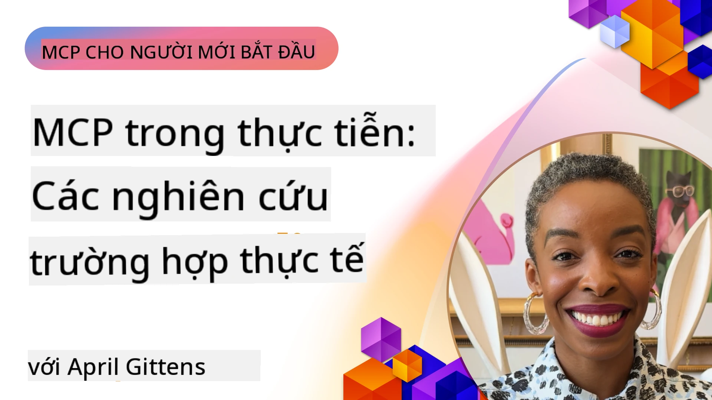

# MCP trong Thực Tiễn: Các Nghiên Cứu Trường Hợp Thế Giới Thực

_(Nhấp vào hình ảnh trên để xem video bài học này)_

Model Context Protocol (MCP) đang thay đổi cách các ứng dụng AI tương tác với dữ liệu, công cụ và dịch vụ. Phần này trình bày các nghiên cứu trường hợp thực tế minh họa các ứng dụng thực tiễn của MCP trong các kịch bản doanh nghiệp khác nhau.

## Tổng Quan

Phần này giới thiệu những ví dụ cụ thể về triển khai MCP, nhấn mạnh cách các tổ chức tận dụng giao thức này để giải quyết các thách thức kinh doanh phức tạp. Qua việc xem xét các nghiên cứu trường hợp này, bạn sẽ có được cái nhìn sâu sắc về tính đa năng, khả năng mở rộng và lợi ích thực tiễn của MCP trong các kịch bản thực tế.

## Mục Tiêu Học Tập Chính

Qua việc khám phá các nghiên cứu trường hợp này, bạn sẽ:

- Hiểu cách MCP có thể áp dụng để giải các vấn đề kinh doanh cụ thể
- Tìm hiểu về các mẫu tích hợp khác nhau và các phương pháp kiến trúc
- Nhận biết các thực hành tốt nhất để triển khai MCP trong môi trường doanh nghiệp
- Nắm bắt các thách thức và giải pháp gặp phải trong các triển khai thực tế
- Xác định cơ hội áp dụng các mẫu tương tự trong các dự án của riêng bạn

## Các Nghiên Cứu Trường Hợp Nổi Bật

### 1. [Đại lý Du lịch AI Azure – Triển khai Tham khảo](./travelagentsample.md)

Nghiên cứu trường hợp này xem xét giải pháp tham khảo toàn diện của Microsoft, minh họa cách xây dựng một ứng dụng lập kế hoạch du lịch nhiều đại lý, được trang bị AI sử dụng MCP, Azure OpenAI và Azure AI Search. Dự án trình bày:

- Điều phối đa đại lý qua MCP
- Tích hợp dữ liệu doanh nghiệp với Azure AI Search
- Kiến trúc an toàn, có khả năng mở rộng sử dụng dịch vụ Azure
- Công cụ có thể mở rộng với các thành phần MCP tái sử dụng được
- Trải nghiệm người dùng trò chuyện được hỗ trợ bởi Azure OpenAI

Kiến trúc và chi tiết triển khai cung cấp cái nhìn quý giá về xây dựng các hệ thống đa đại lý phức tạp với MCP làm lớp điều phối.

### 2. [Cập nhật Mục Azure DevOps từ Dữ liệu YouTube](./UpdateADOItemsFromYT.md)

Nghiên cứu trường hợp này minh họa một ứng dụng thực tiễn của MCP để tự động hóa quy trình làm việc. Nó cho thấy cách các công cụ MCP có thể được sử dụng để:

- Trích xuất dữ liệu từ các nền tảng trực tuyến (YouTube)
- Cập nhật các mục công việc trong hệ thống Azure DevOps
- Tạo các quy trình tự động hóa có thể lặp lại
- Tích hợp dữ liệu qua các hệ thống không đồng nhất

Ví dụ này minh họa cách các triển khai MCP tương đối đơn giản vẫn có thể mang lại hiệu quả lớn bằng việc tự động hóa các tác vụ thường lệ và cải thiện sự nhất quán dữ liệu trên các hệ thống.

### 3. [Truy xuất Tài liệu Thời gian Thực với MCP](./docs-mcp/README.md)

Nghiên cứu trường hợp này hướng dẫn bạn kết nối một khách hàng console Python với máy chủ Model Context Protocol (MCP) để truy xuất và ghi nhận tài liệu Microsoft có nhận thức ngữ cảnh và thời gian thực. Bạn sẽ học cách:

- Kết nối với máy chủ MCP sử dụng khách hàng Python và SDK MCP chính thức
- Sử dụng khách streaming HTTP để truy xuất dữ liệu hiệu quả và thời gian thực
- Gọi các công cụ tài liệu trên máy chủ và ghi nhận phản hồi trực tiếp trên console
- Tích hợp tài liệu Microsoft cập nhật vào quy trình làm việc mà không cần rời khỏi terminal

Chương này bao gồm bài tập thực hành, ví dụ mã tối giản hoạt động và liên kết đến các tài nguyên bổ sung để học sâu hơn. Xem hướng dẫn toàn bộ và mã trong chương được liên kết để hiểu cách MCP có thể chuyển đổi việc truy cập tài liệu và năng suất phát triển trong môi trường console.

### 4. [Ứng dụng Web Tạo Kế hoạch Học Tập Tương tác với MCP](./docs-mcp/README.md)

Nghiên cứu trường hợp này trình bày cách xây dựng một ứng dụng web tương tác sử dụng Chainlit và Model Context Protocol (MCP) để tạo các kế hoạch học tập cá nhân hóa cho bất kỳ chủ đề nào. Người dùng có thể chỉ định một môn học (chẳng hạn như "chứng chỉ AI-900") và thời gian học (ví dụ: 8 tuần), và ứng dụng sẽ cung cấp phần phân chia nội dung theo tuần. Chainlit cho phép giao diện trò chuyện giúp trải nghiệm trở nên hấp dẫn và thích ứng.

- Ứng dụng web tương tác được hỗ trợ bởi Chainlit
- Người dùng đưa ra câu hỏi về chủ đề và thời gian học
- Đề xuất nội dung theo tuần sử dụng MCP
- Phản hồi thích ứng, thời gian thực trong giao diện chat

Dự án minh họa cách AI hội thoại và MCP có thể kết hợp để tạo các công cụ giáo dục động, do người dùng điều khiển trong môi trường web hiện đại.

### 5. [Tài liệu Trong Trình Soạn Thảo với MCP Server trong VS Code](./docs-mcp/README.md)

Nghiên cứu trường hợp này minh họa cách bạn có thể đưa Microsoft Learn Docs trực tiếp vào môi trường VS Code sử dụng máy chủ MCP — không còn phải chuyển đổi tab trình duyệt! Bạn sẽ thấy cách:

- Tìm kiếm và đọc tài liệu ngay trong VS Code thông qua bảng điều khiển MCP hoặc bảng lệnh
- Tham khảo tài liệu và chèn liên kết trực tiếp vào README hoặc các tệp markdown khóa học của bạn
- Sử dụng GitHub Copilot và MCP cùng nhau cho các quy trình tài liệu và mã hóa được hỗ trợ AI trơn tru
- Xác thực và cải thiện tài liệu của bạn với phản hồi thời gian thực và độ chính xác từ Microsoft
- Tích hợp MCP với quy trình GitHub để xác thực tài liệu liên tục

Việc triển khai bao gồm:

- Cấu hình `.vscode/mcp.json` ví dụ để thiết lập dễ dàng
- Hướng dẫn đi qua trải nghiệm trong trình soạn thảo bằng ảnh chụp màn hình
- Mẹo kết hợp Copilot và MCP để đạt năng suất tối đa

Kịch bản này lý tưởng cho tác giả khóa học, người viết tài liệu và nhà phát triển muốn giữ sự tập trung trong trình soạn thảo khi làm việc với tài liệu, Copilot và công cụ xác thực — tất cả đều được hỗ trợ bởi MCP.

### 6. [Tạo MCP Server với APIM](./apimsample.md)

Nghiên cứu trường hợp này cung cấp hướng dẫn từng bước cách tạo máy chủ MCP sử dụng Azure API Management (APIM). Nó bao gồm:

- Thiết lập máy chủ MCP trong Azure API Management
- Mở các thao tác API dưới dạng công cụ MCP
- Cấu hình chính sách cho giới hạn tốc độ và bảo mật
- Kiểm tra máy chủ MCP sử dụng Visual Studio Code và GitHub Copilot

Ví dụ này minh họa cách tận dụng khả năng của Azure để tạo máy chủ MCP mạnh mẽ có thể sử dụng trong các ứng dụng khác nhau, cải thiện tích hợp các hệ thống AI với API doanh nghiệp.

### 7. [Bảng Đăng ký MCP GitHub — Tăng tốc Tích hợp Đại lý](https://github.com/mcp)

Nghiên cứu trường hợp này xem xét cách Bảng Đăng ký MCP của GitHub, ra mắt vào tháng 9 năm 2025, giải quyết một thách thức quan trọng trong hệ sinh thái AI: việc phát hiện và triển khai phân mảnh các máy chủ Model Context Protocol (MCP).

#### Tổng Quan
**Bảng Đăng ký MCP** giải quyết khó khăn ngày càng tăng của việc các máy chủ MCP bị phân tán rải rác trên các kho lưu trữ và đăng ký, điều trước đây làm cho việc tích hợp trở nên chậm chạp và dễ sai sót. Các máy chủ này cho phép đại lý AI tương tác với các hệ thống bên ngoài như API, cơ sở dữ liệu và nguồn tài liệu.

#### Phát Biểu Vấn Đề
Những nhà phát triển xây dựng quy trình làm việc đại lý đã gặp một số thách thức:
- **Khả năng phát hiện kém** các máy chủ MCP trên các nền tảng khác nhau
- **Các câu hỏi thiết lập thừa thãi** rải rác trên diễn đàn và tài liệu
- **Rủi ro bảo mật** từ các nguồn chưa xác minh và không tin cậy
- **Thiếu tiêu chuẩn hóa** về chất lượng và khả năng tương thích của máy chủ

#### Kiến Trúc Giải Pháp
Bảng Đăng ký MCP của GitHub tập trung các máy chủ MCP đáng tin cậy với các tính năng chính:
- **Cài đặt một lần nhấp** tích hợp qua VS Code để thiết lập nhanh chóng
- **Sắp xếp tín hiệu so với nhiễu** theo số sao, hoạt động và xác thực cộng đồng
- **Tích hợp trực tiếp** với GitHub Copilot và các công cụ tương thích MCP khác
- **Mô hình đóng góp mở** cho phép cả cộng đồng và các đối tác doanh nghiệp đóng góp

#### Tác Động Kinh Doanh
Bảng đăng ký đã mang lại những cải thiện đo lường được:
- **Hướng dẫn nhanh hơn** cho nhà phát triển sử dụng các công cụ như Máy chủ Microsoft Learn MCP, vốn truyền tải tài liệu chính thức trực tiếp đến đại lý
- **Năng suất cải thiện** qua các máy chủ chuyên biệt như `github-mcp-server`, cho phép tự động hóa GitHub ngôn ngữ tự nhiên (tạo PR, chạy lại CI, quét mã)
- **Tăng cường niềm tin hệ sinh thái** thông qua danh sách được chọn lọc và tiêu chuẩn cấu hình minh bạch

#### Giá Trị Chiến Lược
Đối với những người thực hành chuyên về quản lý vòng đời đại lý và quy trình làm việc có thể tái tạo, Bảng Đăng ký MCP cung cấp:
- **Khả năng triển khai đại lý mô-đun** với các thành phần chuẩn hóa
- **Các pipeline đánh giá dựa trên bảng đăng ký** cho việc kiểm tra và xác thực nhất quán
- **Tương tác công cụ chéo** cho phép tích hợp liền mạch giữa các nền tảng AI khác nhau

Nghiên cứu trường hợp này chứng minh rằng Bảng Đăng ký MCP không chỉ là một thư mục — đó là nền tảng cơ sở cho tích hợp mô hình có khả năng mở rộng và triển khai hệ thống đại lý thực tế.

### 8. [Xuất bản lên Mạng Xã Hội từ một Đại lý](./publora-social-publishing.md)

Nghiên cứu trường hợp này đi qua một **máy chủ MCP từ xa có khả năng ghi** — các công cụ của nó thực hiện các hành động không thể đảo ngược thay mặt người dùng — lấy xuất bản xã hội làm ví dụ minh họa. Một đại lý soạn bài đăng, một người dùng phê duyệt, và máy chủ lên lịch đăng trên các mạng.

Phần thú vị là các giới hạn thiết kế mà việc xuất bản áp đặt, áp dụng cho bất kỳ máy chủ nào ghi thay vì đọc:

- **Khám phá mở, thực thi được xác thực** — `tools/list` trả lời mà không cần thông tin xác thực để các registry và client có thể kiểm tra, trong khi mỗi `tools/call` yêu cầu mã thông báo và nếu không trả về `401` với tiêu đề `WWW-Authenticate`
- **Đăng ký OAuth không cần bước ngoài băng** — đăng ký client động hiện nay, với Client ID Metadata Documents là hướng mà tiêu chuẩn `2026-07-28` chỉ tới
- **Ghi chú công cụ** (`readOnlyHint`, `destructiveHint`, `idempotentHint`) mà client dùng để quyết định xác nhận gì — gợi ý hơn là bắt buộc, và điều mà các thư mục connector hiện nay mong đợi ở khâu đánh giá
- **Định danh không thể giả tạo**, để giá trị tạo ảo báo lỗi rõ ràng thay vì hành động dựa trên một giá trị trông hợp lý
- **Khóa idempotency trên các công cụ tạo bài đăng**, nên việc thử lại của runtime đại lý không thành bài đăng trùng lặp
- **Mục tiêu noop mô tả trong schema công cụ** để thử toàn bộ đường ghi mà không xuất bản gì, dành cho người đánh giá và CI

Chương kết thúc với một danh sách kiểm tra ngắn mà bạn có thể áp dụng cho một máy chủ bạn đang xây dựng.

## Kết Luận

Tám nghiên cứu trường hợp toàn diện này chứng minh sự đa năng đáng kể và ứng dụng thực tiễn của Model Context Protocol trên nhiều kịch bản thực tế đa dạng. Từ các hệ thống lập kế hoạch du lịch đa đại lý phức tạp và quản lý API doanh nghiệp đến các quy trình tài liệu tinh gọn và Bảng Đăng ký MCP GitHub cách mạng, các ví dụ này minh họa cách MCP cung cấp một cách chuẩn hóa, có khả năng mở rộng để kết nối các hệ thống AI với công cụ, dữ liệu và dịch vụ cần thiết để mang lại giá trị xuất sắc.

Các nghiên cứu trường hợp bao trùm nhiều khía cạnh của triển khai MCP:
- **Tích hợp Doanh nghiệp**: Azure API Management và tự động hóa Azure DevOps
- **Điều phối Đa Đại lý**: Lập kế hoạch du lịch với các đại lý AI phối hợp
- **Năng suất Nhà Phát triển**: Tích hợp VS Code và truy cập tài liệu thời gian thực
- **Phát triển Hệ sinh thái**: Bảng Đăng ký MCP GitHub như một nền tảng cơ sở
- **Ứng dụng Giáo dục**: Trình tạo kế hoạch học tập tương tác và giao diện hội thoại

Qua việc nghiên cứu các triển khai này, bạn sẽ có được những hiểu biết quan trọng về:
- **Mẫu kiến trúc** cho các quy mô và trường hợp sử dụng khác nhau
- **Chiến lược triển khai** cân bằng giữa chức năng và khả năng bảo trì
- **Cân nhắc về bảo mật và khả năng mở rộng** cho các lần triển khai sản xuất
- **Thực hành tốt nhất** trong phát triển máy chủ MCP và tích hợp khách hàng
- **Tư duy hệ sinh thái** để xây dựng các giải pháp AI kết nối với nhau

Các ví dụ này cùng nhau chứng minh rằng MCP không chỉ là một khuôn khổ lý thuyết mà là một giao thức trưởng thành, sẵn sàng sản xuất cho phép giải pháp thực tiễn đối với các thách thức kinh doanh phức tạp. Dù bạn đang xây dựng các công cụ tự động đơn giản hay các hệ thống đa đại lý tinh vi, các mẫu và phương pháp được minh họa tại đây cung cấp nền tảng vững chắc cho các dự án MCP của riêng bạn.

## Tài Nguyên Bổ Sung

- [Kho GitHub Đại lý Du lịch AI Azure](https://github.com/Azure-Samples/azure-ai-travel-agents)
- [Công cụ MCP Azure DevOps](https://github.com/microsoft/azure-devops-mcp)
- [Công cụ MCP Playwright](https://github.com/microsoft/playwright-mcp)
- [Máy chủ MCP Tài liệu Microsoft](https://github.com/MicrosoftDocs/mcp)
- [Bảng Đăng ký MCP GitHub — Tăng tốc Tích hợp Đại lý](https://github.com/mcp)
- [Ví dụ Cộng đồng MCP](https://github.com/microsoft/mcp)

## Tiếp Theo

- Trước: [Module 8: Thực Hành Tốt Nhất](../08-BestPractices/README.md)
- Tiếp: [Module 10: Tinh giản Quy trình AI: Xây dựng Máy chủ MCP với Bộ Công cụ Microsoft Foundry](../10-StreamliningAIWorkflowsBuildingAnMCPServerWithAIToolkit/README.md)

---

<!-- CO-OP TRANSLATOR DISCLAIMER START -->
**Tuyên bố miễn trừ trách nhiệm**:
Tài liệu này đã được dịch bằng dịch vụ dịch thuật AI [Co-op Translator](https://github.com/Azure/co-op-translator). Mặc dù chúng tôi cố gắng đảm bảo độ chính xác, xin lưu ý rằng bản dịch tự động có thể chứa lỗi hoặc sai sót. Tài liệu gốc bằng ngôn ngữ gốc nên được coi là nguồn tin chính thức. Đối với thông tin quan trọng, nên sử dụng dịch vụ dịch thuật chuyên nghiệp bởi con người. Chúng tôi không chịu trách nhiệm về bất kỳ hiểu lầm hoặc giải thích sai nào phát sinh từ việc sử dụng bản dịch này.
<!-- CO-OP TRANSLATOR DISCLAIMER END -->