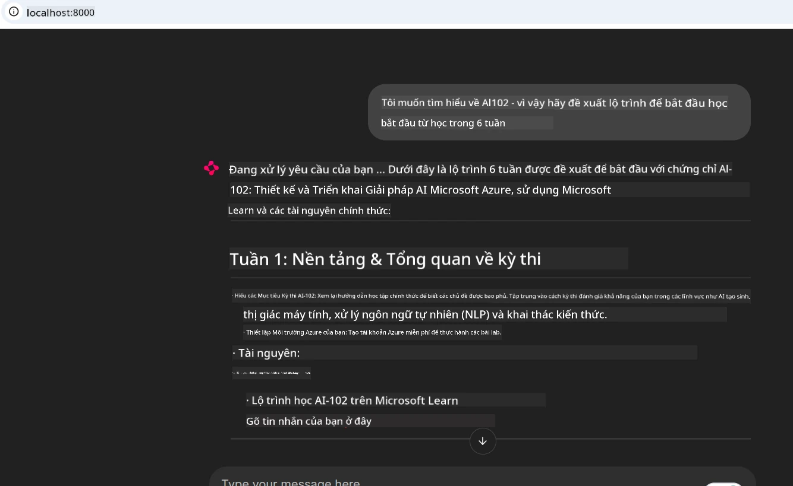
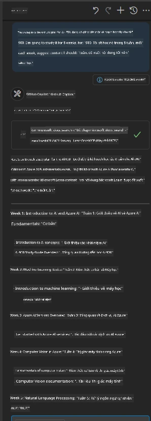

# Nghiên cứu trường hợp: Kết nối với máy chủ Microsoft Learn Docs MCP từ một Client

Bạn đã bao giờ phải vừa chuyển đổi giữa các trang tài liệu, Stack Overflow và nhiều tab công cụ tìm kiếm, trong khi cố gắng giải quyết một vấn đề trong mã của mình chưa? Có thể bạn giữ một màn hình thứ hai chỉ để xem tài liệu, hoặc bạn liên tục chuyển đổi giữa IDE và trình duyệt. Liệu có tốt hơn nếu bạn có thể mang tài liệu ngay vào quy trình làm việc của mình—tích hợp trực tiếp vào ứng dụng, IDE hoặc thậm chí công cụ tùy chỉnh của riêng bạn? Trong nghiên cứu trường hợp này, chúng ta sẽ khám phá cách làm chính xác điều đó bằng cách kết nối trực tiếp với máy chủ Microsoft Learn Docs MCP từ ứng dụng client của bạn.

## Tổng quan

Phát triển hiện đại không chỉ là viết mã—mà còn là tìm đúng thông tin vào đúng thời điểm. Tài liệu có ở khắp nơi, nhưng hiếm khi có mặt ngay tại nơi bạn cần nhất: bên trong công cụ và quy trình làm việc của bạn. Bằng cách tích hợp việc truy xuất tài liệu trực tiếp vào ứng dụng của bạn, bạn có thể tiết kiệm thời gian, giảm việc chuyển đổi ngữ cảnh và tăng năng suất. Trong phần này, chúng tôi sẽ hướng dẫn bạn cách kết nối client với máy chủ Microsoft Learn Docs MCP, để bạn có thể truy cập tài liệu thời gian thực có ngữ cảnh mà không cần rời khỏi ứng dụng.

Chúng ta sẽ đi qua quy trình thiết lập kết nối, gửi yêu cầu và xử lý các phản hồi phát trực tiếp một cách hiệu quả. Cách tiếp cận này không chỉ làm giản lược quy trình làm việc của bạn mà còn mở ra cơ hội xây dựng các công cụ phát triển thông minh hơn và hữu ích hơn.

## Mục tiêu học tập

Tại sao chúng ta lại làm điều này? Bởi vì trải nghiệm nhà phát triển tốt nhất là những trải nghiệm loại bỏ sự cản trở. Hãy tưởng tượng một thế giới nơi trình soạn thảo mã của bạn, chatbot hoặc ứng dụng web có thể trả lời câu hỏi về tài liệu ngay lập tức, sử dụng nội dung mới nhất từ Microsoft Learn. Đến cuối chương này, bạn sẽ biết cách:

- Hiểu những kiến thức cơ bản về giao tiếp giữa máy chủ và client MCP để truy xuất tài liệu
- Triển khai ứng dụng console hoặc web để kết nối với máy chủ Microsoft Learn Docs MCP
- Sử dụng các client HTTP phát trực tiếp để truy xuất tài liệu thời gian thực
- Ghi lại và diễn giải các phản hồi tài liệu trong ứng dụng của bạn

Bạn sẽ thấy kỹ năng này giúp bạn xây dựng các công cụ không chỉ phản hồi mà còn thực sự tương tác và nhận biết ngữ cảnh.

## Kịch bản 1 - Truy xuất tài liệu thời gian thực với MCP

Trong kịch bản này, chúng tôi sẽ hướng dẫn bạn cách kết nối client với máy chủ Microsoft Learn Docs MCP, để bạn có thể truy cập tài liệu có ngữ cảnh và thời gian thực mà không cần rời ứng dụng.

Hãy thực hành điều này. Nhiệm vụ của bạn là viết một ứng dụng kết nối với máy chủ Microsoft Learn Docs MCP, gọi công cụ `microsoft_docs_search`, và ghi lại phản hồi phát trực tiếp vào console.

### Tại sao lại chọn cách này?
Bởi vì đây là nền tảng để xây dựng các tích hợp nâng cao hơn—dù bạn muốn phát triển chatbot, mở rộng IDE hay bảng điều khiển web.

Bạn sẽ tìm thấy mã và hướng dẫn cho kịch bản này trong thư mục [`solution`](./solution/README.md) của nghiên cứu trường hợp. Các bước sẽ hướng dẫn bạn cách thiết lập kết nối:
- Sử dụng SDK MCP chính thức và client HTTP có khả năng phát trực tiếp để kết nối
- Gọi công cụ `microsoft_docs_search` với tham số truy vấn để lấy tài liệu
- Triển khai ghi log và xử lý lỗi phù hợp
- Tạo giao diện console tương tác cho phép người dùng nhập nhiều truy vấn tìm kiếm

Kịch bản này minh họa cách để:
- Kết nối với máy chủ Docs MCP
- Gửi truy vấn
- Phân tích và in kết quả

Đây là ví dụ kết quả khi chạy giải pháp:

```
Prompt> What is Azure Key Vault?
Answer> Azure Key Vault is a cloud service for securely storing and accessing secrets. ...
```

Dưới đây là một giải pháp mẫu tối giản. Mã đầy đủ và chi tiết có trong thư mục giải pháp.

<details>
<summary>Python</summary>

```python
import asyncio
from mcp.client.streamable_http import streamablehttp_client
from mcp import ClientSession

async def main():
    async with streamablehttp_client("https://learn.microsoft.com/api/mcp") as (read_stream, write_stream, _):
        async with ClientSession(read_stream, write_stream) as session:
            await session.initialize()
            result = await session.call_tool("microsoft_docs_search", {"query": "Azure Functions best practices"})
            print(result.content)

if __name__ == "__main__":
    asyncio.run(main())
```

- Để xem triển khai đầy đủ và log, xem [`scenario1.py`](../../../../09-CaseStudy/docs-mcp/solution/python/scenario1.py).
- Để xem hướng dẫn cài đặt và sử dụng, xem file [`README.md`](./solution/python/README.md) trong cùng thư mục.
</details>


## Kịch bản 2 - Ứng dụng Web Tạo Kế hoạch Học tập Tương tác với MCP

Trong kịch bản này, bạn sẽ học cách tích hợp Docs MCP vào một dự án phát triển web. Mục tiêu là cho phép người dùng tìm kiếm tài liệu Microsoft Learn trực tiếp từ giao diện web, giúp truy cập tài liệu ngay lập tức trong ứng dụng hoặc trang web của bạn.

Bạn sẽ học cách:
- Thiết lập ứng dụng web
- Kết nối với máy chủ Docs MCP
- Xử lý đầu vào người dùng và hiển thị kết quả

Đây là ví dụ kết quả khi chạy giải pháp:

```
User> I want to learn about AI102 - so suggest the roadmap to get it started from learn for 6 weeks

Assistant> Here’s a detailed 6-week roadmap to start your preparation for the AI-102: Designing and Implementing a Microsoft Azure AI Solution certification, using official Microsoft resources and focusing on exam skills areas:

---
## Week 1: Introduction & Fundamentals
- **Understand the Exam**: Review the [AI-102 exam skills outline](https://learn.microsoft.com/en-us/credentials/certifications/exams/ai-102/).
- **Set up Azure**: Sign up for a free Azure account if you don't have one.
- **Learning Path**: [Introduction to Azure AI services](https://learn.microsoft.com/en-us/training/modules/intro-to-azure-ai/)
- **Focus**: Get familiar with Azure portal, AI capabilities, and necessary tools.

....more weeks of the roadmap...

Let me know if you want module-specific recommendations or need more customized weekly tasks!
```

Dưới đây là một giải pháp mẫu tối giản. Mã đầy đủ và chi tiết có trong thư mục giải pháp.



<details>
<summary>Python (Chainlit)</summary>

Chainlit là một framework để xây dựng các ứng dụng web AI hội thoại. Nó giúp dễ dàng tạo chatbot và trợ lý tương tác có thể gọi các công cụ MCP và hiển thị kết quả theo thời gian thực. Đây là lựa chọn lý tưởng cho việc tạo nguyên mẫu nhanh và giao diện thân thiện với người dùng.

```python
import chainlit as cl
import requests

MCP_URL = "https://learn.microsoft.com/api/mcp"

@cl.on_message
def handle_message(message):
    query = {"question": message}
    response = requests.post(MCP_URL, json=query)
    if response.ok:
        result = response.json()
        cl.Message(content=result.get("answer", "No answer found.")).send()
    else:
        cl.Message(content="Error: " + response.text).send()
```

- Để xem triển khai đầy đủ, xem [`scenario2.py`](../../../../09-CaseStudy/docs-mcp/solution/python/scenario2.py).
- Để xem hướng dẫn cài đặt và chạy, xem [`README.md`](./solution/python/README.md).
</details>


## Kịch bản 3: Tài liệu Trong Trình Soạn Thảo với Máy chủ MCP trong VS Code

Nếu bạn muốn lấy tài liệu Microsoft Learn trực tiếp trong VS Code (thay vì chuyển đổi tab trình duyệt), bạn có thể sử dụng máy chủ MCP trong trình soạn thảo. Điều này cho phép bạn:
- Tìm kiếm và đọc tài liệu trong VS Code mà không cần rời môi trường lập trình của bạn.
- Tham chiếu tài liệu và chèn liên kết trực tiếp vào README hoặc các tập tin khóa học.
- Kết hợp GitHub Copilot và MCP để có quy trình làm việc tài liệu liền mạch và được hỗ trợ bởi AI.

**Bạn sẽ học cách:**
- Thêm một tập tin `.vscode/mcp.json` hợp lệ vào thư mục gốc workspace (xem ví dụ bên dưới).
- Mở panel MCP hoặc dùng command palette trong VS Code để tìm kiếm và chèn tài liệu.
- Tham chiếu tài liệu trực tiếp trong các file markdown khi bạn làm việc.
- Kết hợp quy trình này với GitHub Copilot để tăng năng suất hơn nữa.

Đây là ví dụ cách thiết lập máy chủ MCP trong VS Code:

```json
{
  "servers": {
    "LearnDocsMCP": {
      "url": "https://learn.microsoft.com/api/mcp"
    }
  }
}
```

</details>

> Để có hướng dẫn chi tiết với ảnh chụp màn hình và các bước từng bước, xem [`README.md`](./solution/scenario3/README.md).



Cách tiếp cận này là lựa chọn lý tưởng cho bất kỳ ai xây dựng các khóa học kỹ thuật, viết tài liệu hoặc phát triển mã với nhu cầu tham khảo thường xuyên.

## Những điểm chính cần nhớ

Việc tích hợp tài liệu trực tiếp vào công cụ của bạn không chỉ là sự tiện lợi—nó là bước thay đổi cuộc chơi đối với năng suất. Bằng cách kết nối với máy chủ Microsoft Learn Docs MCP từ client của bạn, bạn có thể:

- Loại bỏ việc chuyển đổi ngữ cảnh giữa mã và tài liệu
- Truy xuất tài liệu cập nhật, có ngữ cảnh theo thời gian thực
- Xây dựng công cụ phát triển thông minh và tương tác hơn

Những kỹ năng này sẽ giúp bạn tạo ra các giải pháp không chỉ hiệu quả mà còn mang lại trải nghiệm hài lòng khi sử dụng.

## Tài nguyên bổ sung

Để hiểu sâu hơn, hãy khám phá các tài nguyên chính thức sau:

- [Microsoft Learn Docs MCP Server (GitHub)](https://github.com/MicrosoftDocs/mcp)
- [Bắt đầu với Azure MCP Server (mcp-python)](https://learn.microsoft.com/en-us/azure/developer/azure-mcp-server/get-started#create-the-python-app)
- [Azure MCP Server là gì?](https://learn.microsoft.com/en-us/azure/developer/azure-mcp-server/)
- [Giới thiệu về Model Context Protocol (MCP)](https://modelcontextprotocol.io/introduction)
- [Thêm plugin từ MCP Server (Python)](https://learn.microsoft.com/en-us/semantic-kernel/concepts/plugins/adding-mcp-plugins)

## Tiếp theo là gì

- Quay lại: [Tổng quan các nghiên cứu trường hợp](../README.md)
- Tiếp tục đến: [Module 10: Tinh giản quy trình làm việc AI với Bộ công cụ Microsoft Foundry](../../10-StreamliningAIWorkflowsBuildingAnMCPServerWithAIToolkit/README.md)

---

<!-- CO-OP TRANSLATOR DISCLAIMER START -->
**Tuyên bố miễn trừ trách nhiệm**:
Tài liệu này đã được dịch bằng dịch vụ dịch thuật AI [Co-op Translator](https://github.com/Azure/co-op-translator). Mặc dù chúng tôi cố gắng đảm bảo độ chính xác, xin lưu ý rằng bản dịch tự động có thể chứa lỗi hoặc sai sót. Tài liệu gốc bằng ngôn ngữ gốc nên được coi là nguồn tin chính thức. Đối với thông tin quan trọng, nên sử dụng dịch vụ dịch thuật chuyên nghiệp bởi con người. Chúng tôi không chịu trách nhiệm về bất kỳ hiểu lầm hoặc giải thích sai nào phát sinh từ việc sử dụng bản dịch này.
<!-- CO-OP TRANSLATOR DISCLAIMER END -->