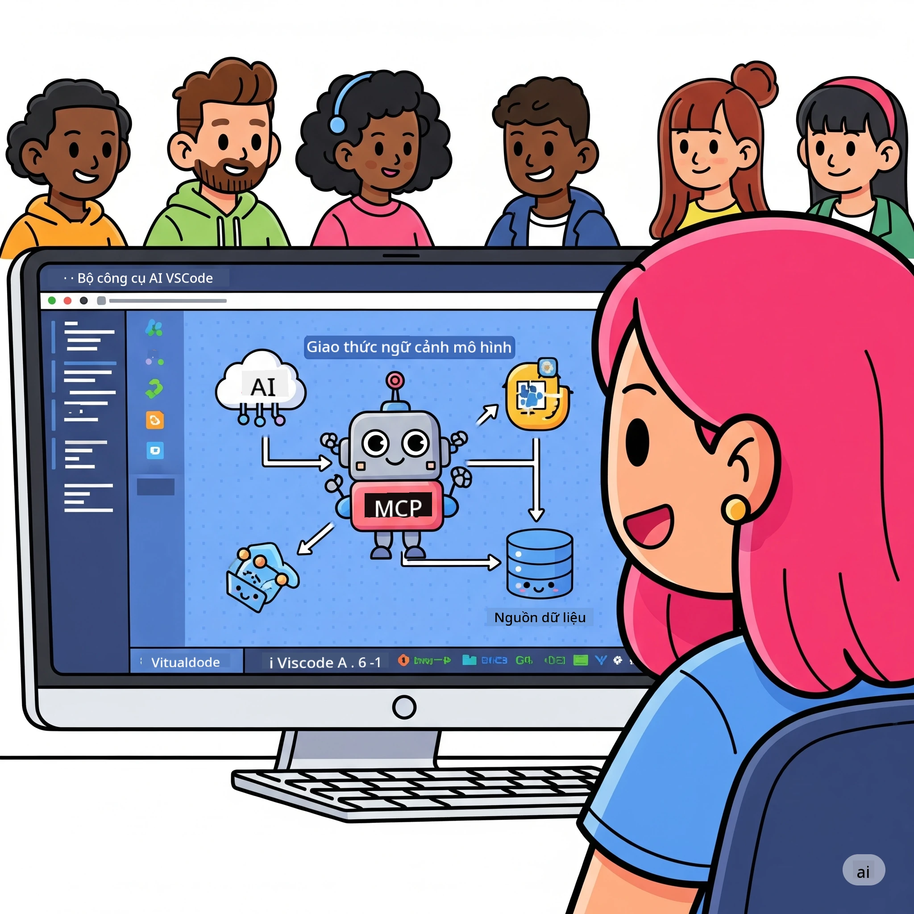
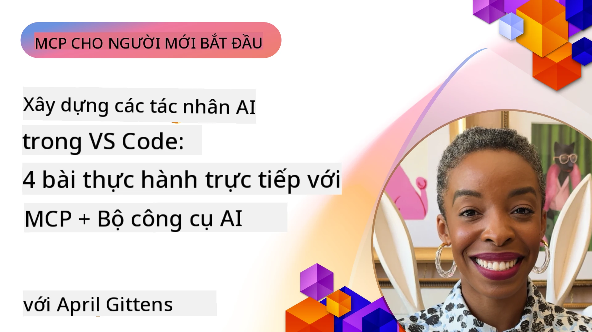

# Tinh giản Quy trình AI: Xây dựng Máy chủ MCP với Bộ công cụ Microsoft Foundry

## 🎯  Tổng quan

_(Nhấp vào hình trên để xem video bài học này)_

Chào mừng đến với **Hội thảo Model Context Protocol (MCP)**! Hội thảo thực hành đầy đủ này kết hợp hai công nghệ tiên tiến để cách mạng hóa phát triển ứng dụng AI:

> **Lưu ý tương thích:** mã hội thảo được xây dựng và thử nghiệm với MCP
> `2025-11-25`, như được thể hiện qua huy hiệu ở trên. Sử dụng
> [đặc tả `2026-07-28` hiện tại](https://modelcontextprotocol.io/specification/2026-07-28/)
> cho các triển khai giao thức mới và xem xét ghi chú phát hành SDK trước
> khi di chuyển các phòng thí nghiệm.

- **🔗 Model Context Protocol (MCP)**: Tiêu chuẩn mở cho tích hợp công cụ AI liền mạch
- **🛠️ Bộ công cụ Microsoft Foundry cho VS Code**: Tiện ích mở rộng phát triển AI quyền năng của Microsoft

### 🎓 Những gì bạn sẽ học

Kết thúc hội thảo này, bạn sẽ thành thạo nghệ thuật xây dựng các ứng dụng thông minh kết nối mô hình AI với các công cụ và dịch vụ thực tế. Từ kiểm thử tự động đến tích hợp API tùy chỉnh, bạn sẽ có kỹ năng thực tiễn để giải quyết các thách thức kinh doanh phức tạp.

## 🏗️ Ngăn xếp công nghệ

### 🔌 Model Context Protocol (MCP)

MCP là **"USB-C cho AI"** - một tiêu chuẩn phổ quát kết nối mô hình AI với công cụ và nguồn dữ liệu bên ngoài.

**✨ Đặc điểm chính:**

- 🔄 **Tích hợp tiêu chuẩn hóa**: Giao diện chung cho kết nối công cụ AI
- 🏛️ **Kiến trúc linh hoạt**: Máy chủ cục bộ & từ xa qua giao thức stdio/SSE
- 🧰 **Hệ sinh thái phong phú**: Công cụ, lời nhắc và tài nguyên trong cùng một giao thức
- 🔒 **Sẵn sàng cho doanh nghiệp**: Bảo mật và độ tin cậy tích hợp sẵn

**🎯 Tại sao MCP quan trọng:**
Giống như USB-C loại bỏ rối loạn dây cáp, MCP loại bỏ sự phức tạp trong tích hợp AI. Một giao thức, vô số khả năng.

### 🤖 Bộ công cụ Microsoft Foundry cho VS Code

Tiện ích mở rộng phát triển AI hàng đầu của Microsoft biến VS Code thành trung tâm quyền năng AI.

**🚀 Khả năng cốt lõi:**

- 📦 **Danh mục mô hình**: Truy cập mô hình từ Azure AI, GitHub, Hugging Face, Ollama
- ⚡ **Suy diễn cục bộ**: Thực thi CPU/GPU/NPU tối ưu ONNX
- 🏗️ **Trình tạo Đại lý**: Phát triển đại lý AI trực quan tích hợp MCP
- 🎭 **Đa Modal**: Hỗ trợ văn bản, hình ảnh và đầu ra cấu trúc

**💡 Lợi ích phát triển:**

- Triển khai mô hình không cần cấu hình
- Kỹ thuật tạo lời nhắc trực quan
- Sân chơi thử nghiệm thời gian thực
- Tích hợp máy chủ MCP liền mạch

## 📚 Hành trình học tập

### [🚀 Module 1: Kiến thức cơ bản Microsoft Foundry Toolkit](./lab1/README.md)

**Thời lượng**: 15 phút

- 🛠️ Cài đặt và cấu hình Microsoft Foundry Toolkit cho VS Code
- 🗂️ Khám phá Danh mục Mô hình (100+ mô hình từ GitHub, ONNX, OpenAI, Anthropic, Google)
- 🎮 Thành thạo Sân chơi Tương tác để thử nghiệm mô hình thời gian thực
- 🤖 Xây dựng đại lý AI đầu tiên với Trình tạo Đại lý
- 📊 Đánh giá hiệu suất mô hình với các chỉ số tích hợp (F1, liên quan, tương đồng, mạch lạc)
- ⚡ Tìm hiểu xử lý theo lô và khả năng hỗ trợ đa modal

**🎯 Kết quả học tập**: Tạo đại lý AI chức năng với hiểu biết toàn diện về khả năng của Microsoft Foundry Toolkit

### [🌐 Module 2: MCP với các kiến thức cơ bản Microsoft Foundry Toolkit](./lab2/README.md)

**Thời lượng**: 20 phút

- 🧠 Thành thạo kiến trúc và các khái niệm của Model Context Protocol (MCP)
- 🌐 Khám phá hệ sinh thái máy chủ MCP của Microsoft
- 🤖 Xây dựng đại lý tự động trình duyệt bằng máy chủ Playwright MCP
- 🔧 Tích hợp máy chủ MCP với Trình tạo Đại lý Microsoft Foundry Toolkit
- 📊 Cấu hình và thử nghiệm công cụ MCP trong đại lý của bạn
- 🚀 Xuất và triển khai đại lý sử dụng MCP cho môi trường sản xuất

**🎯 Kết quả học tập**: Triển khai đại lý AI được tăng cường bằng công cụ bên ngoài qua MCP

### [🔧 Module 3: Phát triển MCP nâng cao với Microsoft Foundry Toolkit](./lab3/README.md)

**Thời lượng**: 20 phút

- 💻 Tạo máy chủ MCP tùy chỉnh với Microsoft Foundry Toolkit
- 🐍 Cấu hình và sử dụng SDK MCP Python mới nhất (v1.9.3)
- 🔍 Thiết lập và sử dụng MCP Inspector để gỡ lỗi
- 🛠️ Xây dựng Máy chủ MCP Thời tiết với quy trình gỡ lỗi chuyên nghiệp
- 🧪 Gỡ lỗi máy chủ MCP trong môi trường Trình tạo Đại lý và Inspector

**🎯 Kết quả học tập**: Phát triển và gỡ lỗi máy chủ MCP tùy chỉnh với công cụ hiện đại

### [🐙 Module 4: Phát triển MCP thực tiễn - Máy chủ GitHub Clone tùy chỉnh](./lab4/README.md)

**Thời lượng**: 30 phút

- 🏗️ Xây dựng Máy chủ MCP GitHub Clone thực tế cho quy trình phát triển
- 🔄 Triển khai nhân bản kho thông minh với xác thực và xử lý lỗi
- 📁 Tạo quản lý thư mục thông minh và tích hợp VS Code
- 🤖 Sử dụng Chế độ Đại lý GitHub Copilot với công cụ MCP tùy chỉnh
- 🛡️ Áp dụng độ tin cậy và tương thích đa nền tảng sẵn sàng sản xuất

**🎯 Kết quả học tập**: Triển khai máy chủ MCP sẵn sàng sản xuất, tinh giản quy trình phát triển thực tế

## 💡 Ứng dụng thực tế & Tác động

### 🏢 Trường hợp sử dụng Doanh nghiệp

#### 🔄 Tự động hóa DevOps

Chuyển đổi quy trình phát triển của bạn với tự động hóa thông minh:

- **Quản lý kho thông minh**: Đánh giá mã và quyết định hợp nhất dựa trên AI
- **CI/CD thông minh**: Tối ưu hóa pipeline tự động dựa trên thay đổi mã
- **Phân loại sự cố**: Phân loại lỗi và phân công tự động

#### 🧪 Cách mạng Đảm bảo Chất lượng

Nâng cao kiểm thử với tự động hóa AI:

- **Tạo thử nghiệm thông minh**: Tạo bộ thử nghiệm toàn diện tự động
- **Kiểm thử hồi quy trực quan**: Phát hiện thay đổi UI bằng AI
- **Giám sát hiệu suất**: Phát hiện và giải quyết sự cố chủ động

#### 📊 Thông minh quy trình dữ liệu

Xây dựng quy trình xử lý dữ liệu thông minh hơn:

- **Quy trình ETL thích ứng**: Tự tối ưu biến đổi dữ liệu
- **Phát hiện bất thường**: Giám sát chất lượng dữ liệu thời gian thực
- **Định tuyến thông minh**: Quản lý luồng dữ liệu thông minh

#### 🎧 Nâng cao trải nghiệm khách hàng

Tạo tương tác khách hàng xuất sắc:

- **Hỗ trợ hiểu bối cảnh**: Đại lý AI truy cập lịch sử khách hàng
- **Giải quyết sự cố chủ động**: Dịch vụ khách hàng dự đoán
- **Tích hợp đa kênh**: Trải nghiệm AI nhất quán trên các nền tảng

## 🛠️ Yêu cầu & Cài đặt

### 💻 Yêu cầu hệ thống

| Thành phần | Yêu cầu | Ghi chú |
|-----------|-------------|-------|
| **Hệ điều hành** | Windows 10+, macOS 10.15+, Linux | Bất kỳ hệ điều hành hiện đại |
| **Visual Studio Code** | Phiên bản ổn định mới nhất | Cần cho Microsoft Foundry Toolkit |
| **Node.js** | v18.0+ và npm | Cho phát triển máy chủ MCP |
| **Python** | 3.10+ | Tùy chọn cho máy chủ MCP Python |
| **Bộ nhớ** | Tối thiểu 8GB RAM | Khuyến nghị 16GB cho mô hình cục bộ |

### 🔧 Môi trường phát triển

#### Tiện ích mở rộng VS Code được đề xuất

- **Microsoft Foundry Toolkit** (ms-windows-ai-studio.windows-ai-studio)
- **Python** (ms-python.python)
- **Trình gỡ lỗi Python** (ms-python.debugpy)
- **GitHub Copilot** (GitHub.copilot) - Tùy chọn nhưng hữu ích

#### Công cụ tùy chọn

- **uv**: Trình quản lý gói Python hiện đại
- **MCP Inspector**: Công cụ gỡ lỗi trực quan cho máy chủ MCP
- **Playwright**: Cho ví dụ tự động hóa web

## 🎖️ Kết quả học tập & Lộ trình chứng nhận

### 🏆 Danh sách Kiểm tra Thành thạo Kỹ năng

Hoàn thành hội thảo này, bạn sẽ đạt được thành thạo trong:

#### 🎯 Năng lực cốt lõi

- [ ] **Thành thạo Giao thức MCP**: Hiểu sâu kiến trúc và mẫu triển khai
- [ ] **Thành thạo Microsoft Foundry Toolkit**: Sử dụng cấp chuyên gia cho phát triển nhanh
- [ ] **Phát triển Máy chủ Tùy chỉnh**: Xây dựng, triển khai và duy trì máy chủ MCP sản xuất
- [ ] **Xuất sắc trong tích hợp công cụ**: Kết nối AI liền mạch với quy trình phát triển hiện có
- [ ] **Ứng dụng Kỹ năng Giải quyết Vấn đề**: Áp dụng kỹ năng học để giải quyết thách thức kinh doanh thực tế

#### 🔧 Kỹ năng kỹ thuật

- [ ] Thiết lập và cấu hình Microsoft Foundry Toolkit trong VS Code
- [ ] Thiết kế và triển khai máy chủ MCP tùy chỉnh
- [ ] Tích hợp mô hình Microsoft Foundry với kiến trúc MCP
- [ ] Xây dựng quy trình thử nghiệm tự động với Playwright
- [ ] Triển khai đại lý AI cho môi trường sản xuất
- [ ] Gỡ lỗi và tối ưu hiệu năng máy chủ MCP

#### 🚀 Khả năng nâng cao

- [ ] Thiết kế kiến trúc tích hợp AI quy mô doanh nghiệp
- [ ] Triển khai tốt nhất bảo mật cho ứng dụng AI
- [ ] Thiết kế kiến trúc máy chủ MCP có thể mở rộng
- [ ] Tạo chuỗi công cụ tùy chỉnh cho lĩnh vực cụ thể
- [ ] Hướng dẫn người khác phát triển AI bản địa

## 📖 Tài nguyên bổ sung

- [Đặc tả MCP (2026-07-28)](https://modelcontextprotocol.io/specification/2026-07-28/)
- [Kho Microsoft Foundry Toolkit trên GitHub](https://github.com/microsoft/vscode-ai-toolkit)
- [Bộ sưu tập Máy chủ MCP mẫu](https://github.com/modelcontextprotocol/servers)
- [Hướng dẫn Thực hành Tốt nhất](https://modelcontextprotocol.io/docs/best-practices)
- [OWASP MCP Top 10](https://microsoft.github.io/mcp-azure-security-guide/mcp/) - Thực hành bảo mật tốt nhất

---

**🚀 Sẵn sàng cách mạng hóa quy trình phát triển AI của bạn?**

Hãy cùng xây dựng tương lai của các ứng dụng thông minh với MCP và Bộ công cụ Microsoft Foundry!

## Tiếp theo là gì

Tiếp tục đến: [Module 11: Phòng thí nghiệm thực hành Máy chủ MCP](../11-MCPServerHandsOnLabs/README.md)

---

<!-- CO-OP TRANSLATOR DISCLAIMER START -->
**Tuyên bố miễn trừ trách nhiệm**:
Tài liệu này đã được dịch bằng dịch vụ dịch thuật AI [Co-op Translator](https://github.com/Azure/co-op-translator). Mặc dù chúng tôi cố gắng đảm bảo độ chính xác, xin lưu ý rằng bản dịch tự động có thể chứa lỗi hoặc sai sót. Tài liệu gốc bằng ngôn ngữ gốc nên được coi là nguồn tin chính thức. Đối với thông tin quan trọng, nên sử dụng dịch vụ dịch thuật chuyên nghiệp bởi con người. Chúng tôi không chịu trách nhiệm về bất kỳ hiểu lầm hoặc giải thích sai nào phát sinh từ việc sử dụng bản dịch này.
<!-- CO-OP TRANSLATOR DISCLAIMER END -->