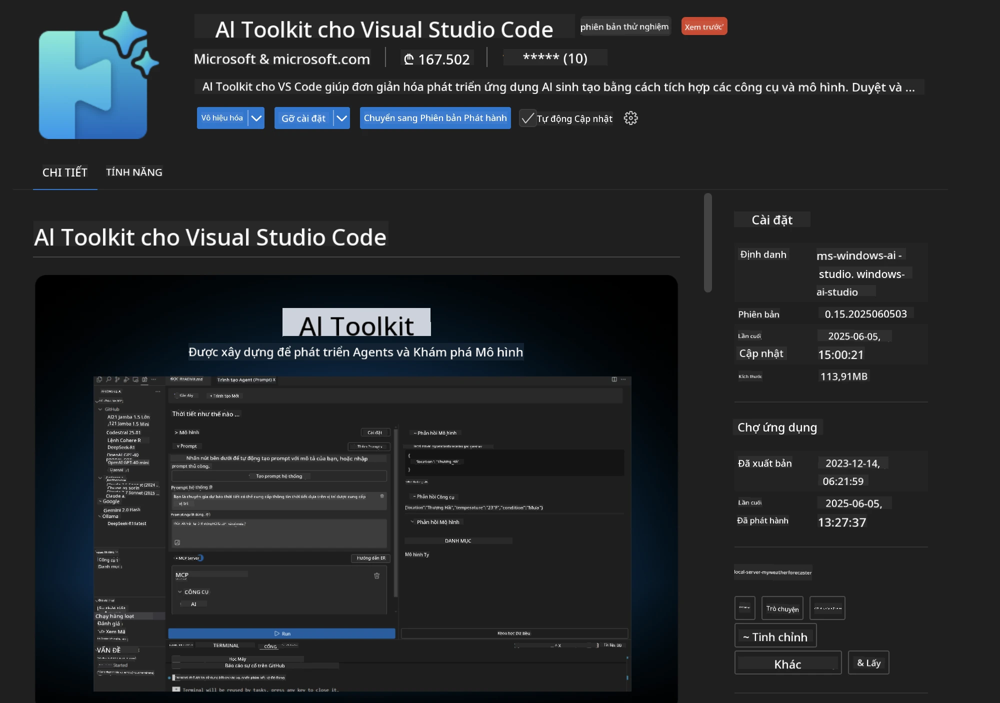
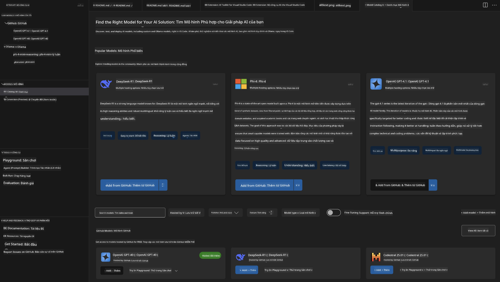
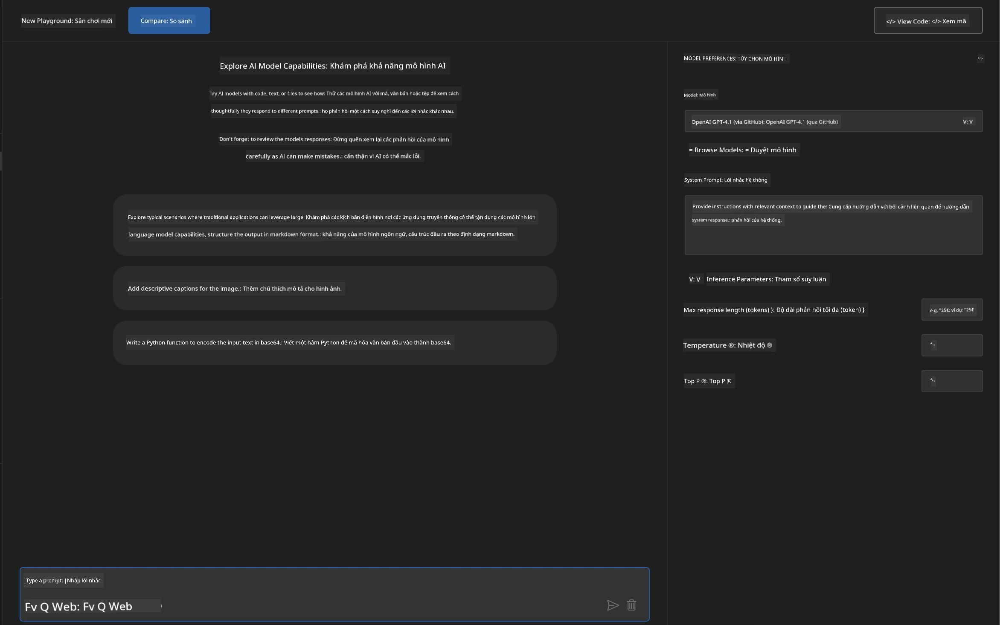
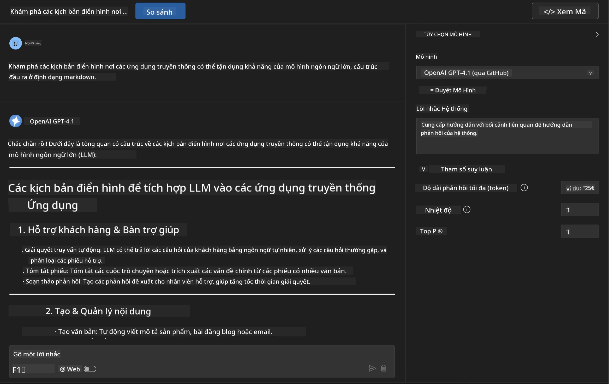
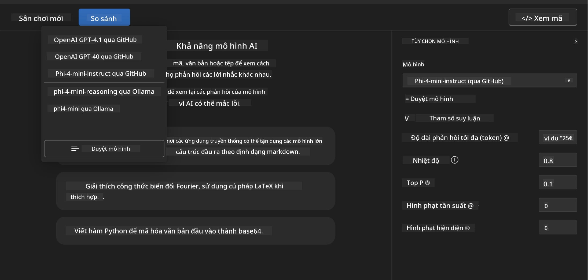
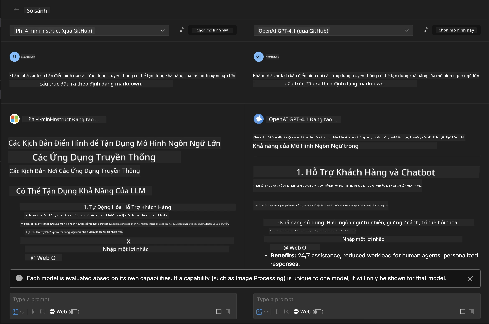
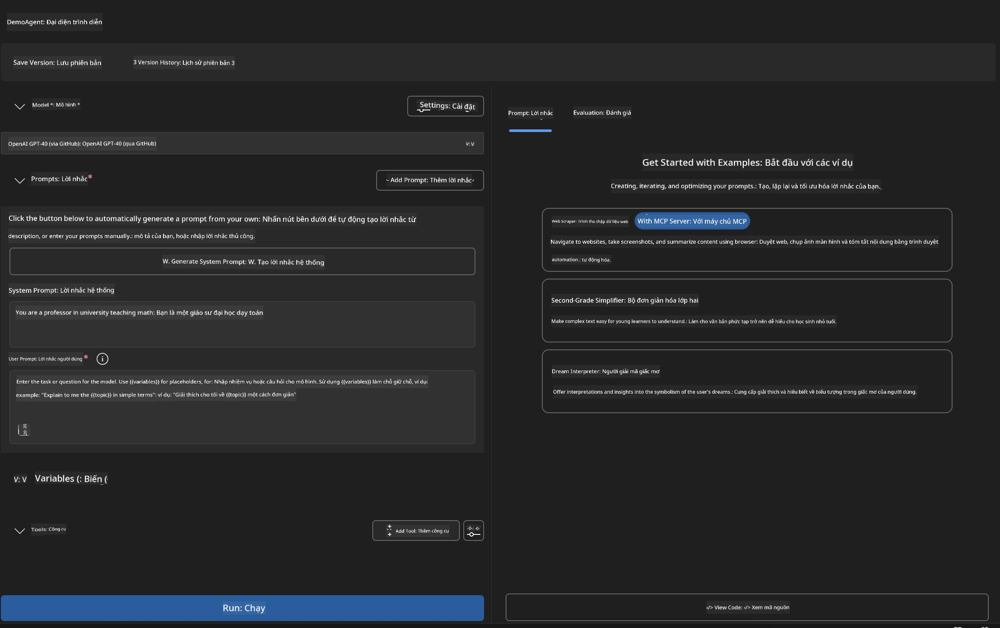
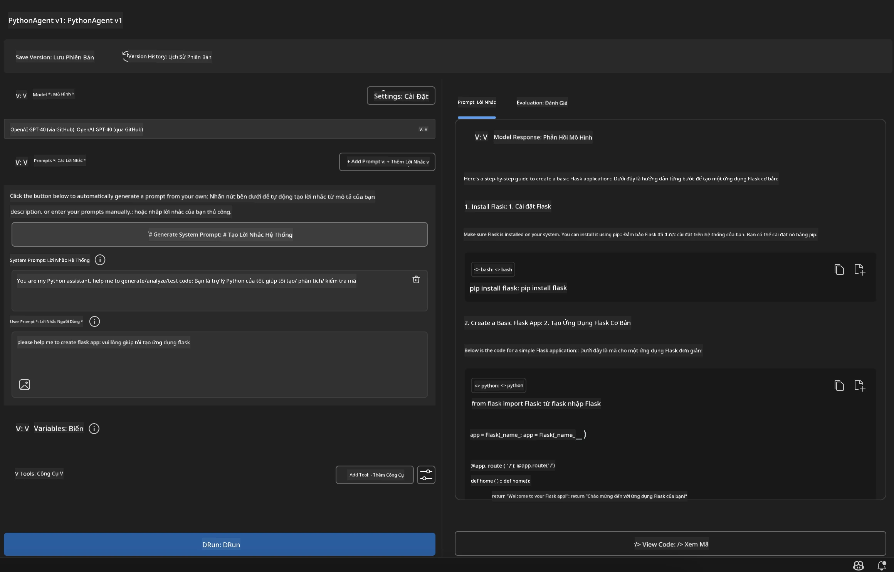

# 🚀 Module 1: Những Kiến Thức Cơ Bản về Bộ Công Cụ Microsoft Foundry

[]()
[]()
[]()

## 📋 Mục Tiêu Học Tập

Vào cuối module này, bạn sẽ có thể:
- ✅ Cài đặt và cấu hình Tiện ích mở rộng Microsoft Foundry Toolkit cho VS Code
- ✅ Duyệt qua Danh mục Mô hình và hiểu các nguồn mô hình khác nhau
- ✅ Sử dụng Playground để thử nghiệm và thử nghiệm mô hình
- ✅ Tạo các tác nhân AI tùy chỉnh bằng Agent Builder
- ✅ So sánh hiệu suất mô hình giữa các nhà cung cấp khác nhau
- ✅ Áp dụng các thực hành tốt nhất cho thiết kế prompt

## 🧠 Giới Thiệu về Bộ Công Cụ Microsoft Foundry

**Tiện ích mở rộng Microsoft Foundry Toolkit cho VS Code** là tiện ích mở rộng chủ lực của Microsoft biến VS Code thành môi trường phát triển AI toàn diện. Nó kết nối khoảng cách giữa nghiên cứu AI và phát triển ứng dụng thực tiễn, giúp AI tạo sinh trở nên dễ tiếp cận với các nhà phát triển ở mọi trình độ.

### 🌟 Các Tính Năng Chính

| Tính Năng | Mô Tả | Trường Hợp Sử Dụng |
|---------|-------------|----------|
| **🗂️ Danh mục Mô hình** | Truy cập hơn 100 mô hình từ GitHub, ONNX, OpenAI, Anthropic, Google | Khám phá và chọn mô hình |
| **🔌 Hỗ trợ BYOM** | Tích hợp mô hình của bạn (cục bộ/từ xa) | Triển khai mô hình tùy chỉnh |
| **🎮 Playground Tương tác** | Thử nghiệm mô hình thời gian thực với giao diện chat | Phát triển nguyên mẫu và thử nghiệm nhanh |
| **📎 Hỗ trợ đa phương tiện** | Xử lý văn bản, hình ảnh và tệp đính kèm | Ứng dụng AI phức tạp |
| **⚡ Xử lý hàng loạt** | Chạy nhiều prompt cùng lúc | Quy trình thử nghiệm hiệu quả |
| **📊 Đánh giá mô hình** | Các chỉ số tích hợp (F1, liên quan, tương tự, mạch lạc) | Đánh giá hiệu suất |

### 🎯 Tại Sao Bộ Công Cụ Microsoft Foundry Quan Trọng

- **🚀 Phát triển tăng tốc**: Từ ý tưởng đến nguyên mẫu trong vài phút
- **🔄 Quy trình làm việc thống nhất**: Một giao diện cho nhiều nhà cung cấp AI
- **🧪 Dễ dàng thử nghiệm**: So sánh mô hình mà không cần cài đặt phức tạp
- **📈 Sẵn sàng sản xuất**: Chuyển đổi liền mạch từ nguyên mẫu sang triển khai

## 🛠️ Yêu Cầu & Cài Đặt

### 📦 Cài đặt Tiện ích mở rộng Microsoft Foundry Toolkit

**Bước 1: Truy cập Cửa hàng Tiện ích mở rộng**
1. Mở Visual Studio Code
2. Điều hướng đến chế độ xem Tiện ích mở rộng (`Ctrl+Shift+X` hoặc `Cmd+Shift+X`)
3. Tìm kiếm "Microsoft Foundry Toolkit"

**Bước 2: Chọn Phiên bản của Bạn**
- **🟢 Bản phát hành**: Được khuyến nghị cho sử dụng sản xuất
- **🔶 Bản tiền phát hành**: Truy cập sớm các tính năng mới nhất

**Bước 3: Cài đặt và Kích hoạt**



### ✅ Danh sách Kiểm tra Xác nhận
- [ ] Biểu tượng Microsoft Foundry Toolkit xuất hiện ở thanh bên VS Code
- [ ] Tiện ích mở rộng đã được bật và kích hoạt
- [ ] Không có lỗi cài đặt trong bảng đầu ra

## 🧪 Bài Tập Thực Hành 1: Khám Phá Mô Hình Microsoft Foundry

**🎯 Mục tiêu**: Làm chủ Danh mục Mô hình và thử nghiệm mô hình AI đầu tiên của bạn

### 📊 Bước 1: Duyệt Qua Danh mục Mô hình

Danh mục Mô hình là cánh cổng dẫn bạn đến hệ sinh thái AI. Nó tổng hợp các mô hình từ nhiều nhà cung cấp, giúp bạn dễ dàng khám phá và so sánh các lựa chọn.

**🔍 Hướng dẫn Duyệt:**

Nhấp vào **MODELS - Catalog** trong thanh bên Microsoft Foundry Toolkit



**💡 Mẹo Chuyên Nghiệp**: Tìm các mô hình có khả năng cụ thể phù hợp với trường hợp sử dụng của bạn (ví dụ: tạo mã, viết sáng tạo, phân tích).

> [!NOTE]
> Mô hình GitHub đã được ngưng vào ngày 30 tháng 7 năm 2026. Hãy sử dụng mô hình Microsoft Foundry để triển khai và xác thực bằng Microsoft Entra ID hoặc khóa API Azure.
> 

### 🚀 Bước 2: Thêm và Cấu hình Mô hình Đầu tiên của Bạn

**Chiến lược Lựa chọn Mô hình:**
- **GPT-5.1**: Mô hình đa năng được khuyến nghị dùng cho công cụ và lý luận
- **Phi-4-mini**: Nhẹ, phản hồi nhanh cho các tác vụ đơn giản

**🔧 Quá trình Cấu hình:**
1. Chọn **OpenAI GPT-5.1** từ danh mục
2. Nhấp **Add to My Models** - điều này đăng ký mô hình để sử dụng
3. Chọn **Try in Playground** để khởi chạy môi trường thử nghiệm
4. Chờ khởi tạo mô hình (lần đầu có thể mất thời gian)



**⚙️ Hiểu Các Tham Số Mô hình:**
- **Temperature**: Kiểm soát độ sáng tạo (0 = xác định, 1 = sáng tạo)
- **Max Tokens**: Độ dài phản hồi tối đa
- **Top-p**: Lấy mẫu nhân tố hạt nhân cho sự đa dạng phản hồi

### 🎯 Bước 3: Làm Chủ Giao Diện Playground

Playground là phòng thí nghiệm thử nghiệm AI của bạn. Đây là cách tận dụng tối đa tiềm năng của nó:

**🎨 Thực hành tốt nhất cho thiết kế prompt:**
1. **Cụ thể**: Hướng dẫn rõ ràng, chi tiết mang lại kết quả tốt hơn
2. **Cung cấp bối cảnh**: Bao gồm thông tin nền phù hợp
3. **Dùng ví dụ**: Cho mô hình thấy bạn muốn gì qua ví dụ
4. **Lặp lại**: Tinh chỉnh prompt dựa trên kết quả ban đầu

**🧪 Kịch bản thử nghiệm:**
```markdown
# Example 1: Code Generation
"Write a Python function that calculates the factorial of a number using recursion. Include error handling and docstrings."

# Example 2: Creative Writing
"Write a professional email to a client explaining a project delay, maintaining a positive tone while being transparent about challenges."

# Example 3: Data Analysis
"Analyze this sales data and provide insights: [paste your data]. Focus on trends, anomalies, and actionable recommendations."
```



### 🏆 Bài Tập Thách Thức: So Sánh Hiệu Suất Mô hình

**🎯 Mục Tiêu**: So sánh các mô hình khác nhau sử dụng cùng prompt để hiểu điểm mạnh của chúng

**📋 Hướng dẫn:**
1. Thêm **Phi-4-mini** vào không gian làm việc của bạn
2. Sử dụng cùng một prompt cho cả GPT-5.1 và Phi-4-mini



3. So sánh chất lượng phản hồi, tốc độ và độ chính xác
4. Ghi lại kết quả vào phần kết quả



**💡 Những Kiến Thức Quan Trọng Cần Khám Phá:**
- Khi nào nên dùng LLM và khi nào nên dùng SLM
- Đánh đổi chi phí và hiệu suất
- Khả năng chuyên biệt của các mô hình khác nhau

## 🤖 Bài Tập Thực Hành 2: Tạo Tác Nhân Tùy Chỉnh với Agent Builder

**🎯 Mục tiêu**: Tạo các tác nhân AI chuyên biệt phù hợp với các tác vụ và quy trình làm việc cụ thể

### 🏗️ Bước 1: Hiểu về Agent Builder

Agent Builder là nơi Microsoft Foundry Toolkit thực sự tỏa sáng. Nó cho phép bạn tạo các trợ lý AI chuyên biệt kết hợp sức mạnh của mô hình ngôn ngữ lớn với các hướng dẫn tùy chỉnh, tham số cụ thể và kiến thức chuyên môn.

**🧠 Thành phần kiến trúc tác nhân:**
- **Mô hình Cốt lõi**: LLM nền tảng (GPT-5.1, Phi, v.v.)
- **System Prompt**: Xác định cá tính và hành vi tác nhân
- **Tham số**: Cài đặt tinh chỉnh để hiệu suất tối ưu
- **Tích hợp Công cụ**: Kết nối với API bên ngoài và dịch vụ MCP
- **Bộ nhớ**: Bối cảnh hội thoại và duy trì phiên làm việc



### ⚙️ Bước 2: Đào sâu cấu hình tác nhân

**🎨 Tạo System Prompt hiệu quả:**
```markdown
# Template Structure:
## Role Definition
You are a [specific role] with expertise in [domain].

## Capabilities
- List specific abilities
- Define scope of knowledge
- Clarify limitations

## Behavior Guidelines
- Response style (formal, casual, technical)
- Output format preferences
- Error handling approach

## Examples
Provide 2-3 examples of ideal interactions
```

*Dĩ nhiên, bạn cũng có thể dùng tính năng Generate System Prompt để AI giúp bạn tạo và tối ưu prompt*

**🔧 Tối ưu hóa tham số:**
| Tham số | Khoảng Khuyến nghị | Trường hợp sử dụng |
|-----------|------------------|----------|
| **Temperature** | 0.1-0.3 | Phản hồi kỹ thuật/chính xác |
| **Temperature** | 0.7-0.9 | Tác vụ sáng tạo/động não |
| **Max Tokens** | 500-1000 | Phản hồi cô đọng |
| **Max Tokens** | 2000-4000 | Giải thích chi tiết |

### 🐍 Bước 3: Bài Tập Thực Tế - Tác nhân Lập trình Python

**🎯 Nhiệm vụ**: Tạo trợ lý lập trình Python chuyên biệt

**📋 Các bước cấu hình:**

1. **Chọn Mô hình**: Chọn **Claude 3.5 Sonnet** (xuất sắc cho mã)

2. **Thiết kế System Prompt**:
```markdown
# Python Programming Expert Agent

## Role
You are a senior Python developer with 10+ years of experience. You excel at writing clean, efficient, and well-documented Python code.

## Capabilities
- Write production-ready Python code
- Debug complex issues
- Explain code concepts clearly
- Suggest best practices and optimizations
- Provide complete working examples

## Response Format
- Always include docstrings
- Add inline comments for complex logic
- Suggest testing approaches
- Mention relevant libraries when applicable

## Code Quality Standards
- Follow PEP 8 style guidelines
- Use type hints where appropriate
- Handle exceptions gracefully
- Write readable, maintainable code
```

3. **Cấu hình Tham số**:
   - Temperature: 0.2 (cho mã ổn định, đáng tin cậy)
   - Max Tokens: 2000 (giải thích chi tiết)
   - Top-p: 0.9 (sáng tạo cân bằng)



### 🧪 Bước 4: Thử nghiệm Tác nhân Python của Bạn

**Kịch bản thử nghiệm:**
1. **Chức năng cơ bản**: "Tạo hàm tìm số nguyên tố"
2. **Thuật toán phức tạp**: "Triển khai cây tìm kiếm nhị phân với các phương thức chèn, xóa và tìm kiếm"
3. **Vấn đề thực tế**: "Xây dựng trình thu thập dữ liệu web xử lý giới hạn tốc độ và thử lại"
4. **Gỡ lỗi**: "Sửa đoạn mã này [dán mã lỗi]"

**🏆 Tiêu chí thành công:**
- ✅ Mã chạy không lỗi
- ✅ Có tài liệu hướng dẫn đúng cách
- ✅ Tuân thủ các thực hành tốt nhất của Python
- ✅ Giải thích rõ ràng
- ✅ Đề xuất các cải tiến

## 🎓 Kết Thúc Module 1 & Các Bước Tiếp Theo

### 📊 Kiểm Tra Kiến Thức

Kiểm tra sự hiểu biết của bạn:
- [ ] Bạn có thể giải thích sự khác biệt giữa các mô hình trong danh mục không?
- [ ] Bạn đã tạo và thử nghiệm tác nhân tùy chỉnh thành công chưa?
- [ ] Bạn có hiểu cách tối ưu tham số cho các trường hợp sử dụng khác nhau không?
- [ ] Bạn có thể thiết kế các system prompt hiệu quả không?

### 📚 Tài Nguyên Bổ Sung

- **Tài liệu Microsoft Foundry Toolkit**: [Tài liệu chính thức của Microsoft](https://github.com/microsoft/vscode-ai-toolkit)
- **Hướng dẫn Thiết kế prompt**: [Thực hành tốt nhất](https://platform.openai.com/docs/guides/prompt-engineering)
- **Mô hình trong Microsoft Foundry Toolkit**: [Các mô hình đang phát triển](https://github.com/microsoft/vscode-ai-toolkit/blob/main/doc/models.md)

**🎉 Chúc mừng!** Bạn đã làm chủ các kiến thức cơ bản về Microsoft Foundry Toolkit và sẵn sàng xây dựng các ứng dụng AI nâng cao hơn!

### 🔜 Tiếp tục sang Module tiếp theo

Sẵn sàng với các khả năng nâng cao hơn? Tiếp tục đến **[Module 2: MCP với Những Kiến Thức Cơ Bản về Microsoft Foundry Toolkit](../lab2/README.md)** nơi bạn sẽ học cách:
- Kết nối tác nhân của bạn với các công cụ bên ngoài bằng Giao thức Ngữ cảnh Mô hình (Model Context Protocol - MCP)
- Xây dựng tác nhân tự động hóa trình duyệt với Playwright
- Tích hợp các máy chủ MCP với tác nhân Microsoft Foundry Toolkit của bạn
- Tăng cường tác nhân của bạn với dữ liệu và khả năng bên ngoài

---

<!-- CO-OP TRANSLATOR DISCLAIMER START -->
**Tuyên bố miễn trừ trách nhiệm**:
Tài liệu này đã được dịch bằng dịch vụ dịch thuật AI [Co-op Translator](https://github.com/Azure/co-op-translator). Mặc dù chúng tôi cố gắng đảm bảo độ chính xác, xin lưu ý rằng bản dịch tự động có thể chứa lỗi hoặc sai sót. Tài liệu gốc bằng ngôn ngữ gốc nên được coi là nguồn tin chính thức. Đối với thông tin quan trọng, nên sử dụng dịch vụ dịch thuật chuyên nghiệp bởi con người. Chúng tôi không chịu trách nhiệm về bất kỳ hiểu lầm hoặc giải thích sai nào phát sinh từ việc sử dụng bản dịch này.
<!-- CO-OP TRANSLATOR DISCLAIMER END -->