# 🌐 Module 2: MCP với Những Kiến Thức Cơ Bản về Microsoft Foundry Toolkit


## 📋 Mục Tiêu Học Tập

Đến cuối module này, bạn sẽ có thể:

- ✅ Hiểu kiến trúc và lợi ích của Giao thức Bối cảnh Mô hình (MCP)
- ✅ Khám phá hệ sinh thái máy chủ MCP của Microsoft
- ✅ Tích hợp các máy chủ MCP với Microsoft Foundry Toolkit Agent Builder
- ✅ Xây dựng một tác nhân tự động trình duyệt hoạt động bằng Playwright MCP
- ✅ Cấu hình và kiểm thử các công cụ MCP trong tác nhân của bạn
- ✅ Xuất và triển khai các tác nhân dùng MCP vào sản xuất

## 🎯 Xây Dựng Dựa Trên Module 1

Trong Module 1, chúng ta đã nắm vững các kiến thức cơ bản về Microsoft Foundry Toolkit và tạo
tác nhân Python đầu tiên của mình. Bây giờ chúng ta sẽ **tăng cường sức mạnh** cho các tác nhân
đó bằng cách kết nối chúng với các công cụ và dịch vụ bên ngoài thông qua giao thức cách mạng
**Model Context Protocol (MCP)**.

Hãy nghĩ về điều này như việc nâng cấp từ một máy tính bỏ túi cơ bản thành một chiếc máy tính hoàn chỉnh.
Các tác nhân AI của bạn sẽ có khả năng:

- 🌐 Duyệt web và tương tác với các trang web
- 📁 Truy cập và thao tác với các tệp tin
- 🔧 Tích hợp với các hệ thống doanh nghiệp
- 📊 Xử lý dữ liệu thời gian thực từ các API

## 🧠 Hiểu về Model Context Protocol (MCP)

### 🔍 MCP là gì?

Model Context Protocol (MCP) là **"USB-C cho các ứng dụng AI"**: một tiêu chuẩn mở
kết nối Các Mô hình Ngôn ngữ Lớn (LLMs) với các công cụ, nguồn dữ liệu và dịch vụ bên ngoài.
Giống như USB-C cung cấp một đầu nối phổ quát, MCP giảm độ phức tạp tích hợp AI thông qua một
giao thức tiêu chuẩn.

### 🎯 Vấn đề MCP Giải Quyết

**Trước MCP:**

- 🔧 Tích hợp tùy chỉnh cho từng công cụ
- 🔄 Bị ràng buộc nhà cung cấp với các giải pháp độc quyền  
- 🔒 Lỗ hổng bảo mật do các kết nối tự phát
- ⏱️ Nhiều tháng phát triển cho các tích hợp cơ bản

**Với MCP:**

- ⚡ Tích hợp công cụ cắm là chạy
- 🔄 Kiến trúc không ràng buộc nhà cung cấp
- 🛡️ Thực hành bảo mật tích hợp sẵn
- 🚀 Thêm khả năng mới chỉ trong vài phút

### 🏗️ Kiến Trúc MCP Chi Tiết

MCP tuân theo kiến trúc **máy khách - máy chủ** tạo ra một hệ sinh thái bảo mật và có thể mở rộng:

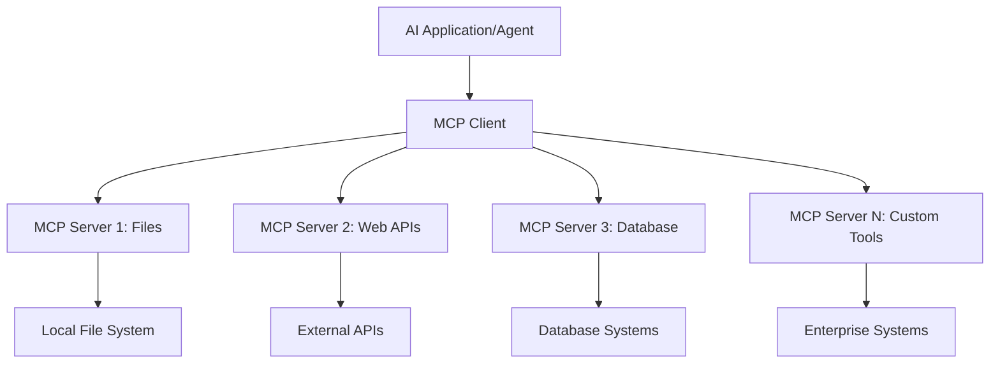

**🔧 Các Thành Phần Chính:**

| Thành Phần | Vai Trò | Ví Dụ |
| --------- | ---- | -------- |
| **MCP Hosts** | Tiêu thụ dịch vụ MCP | VS Code, Foundry Toolkit |
| **MCP Clients** | Xử lý kết nối giao thức | Tích hợp trong hosts |
| **MCP Servers** | Cung cấp các khả năng | Playwright, Files, Azure, GitHub |
| **Transport Layer** | Kết nối client và server | stdio, HTTP, WebSockets |

## 🏢 Hệ Sinh Thái Máy Chủ MCP của Microsoft

Microsoft dẫn đầu hệ sinh thái MCP với bộ máy chủ cấp doanh nghiệp toàn diện
đáp ứng nhu cầu kinh doanh thực tế.

### 🌟 Các Máy Chủ MCP Nổi Bật của Microsoft

#### 1. ☁️ Máy Chủ Azure MCP

**🔗 Kho Mã**: [azure/azure-mcp](https://github.com/azure/azure-mcp)
**🎯 Mục Đích**: Quản lý tài nguyên Azure toàn diện với tích hợp AI

**✨ Các Tính Năng Chính:**

- Cung cấp hạ tầng dạng khai báo
- Giám sát tài nguyên theo thời gian thực
- Đề xuất tối ưu chi phí
- Kiểm tra tuân thủ bảo mật

**🚀 Trường Hợp Sử Dụng:**

- Hạ tầng như mã với hỗ trợ AI
- Tự động điều chỉnh tài nguyên
- Tối ưu chi phí đám mây
- Tự động hóa quy trình DevOps

#### 2. 📊 Microsoft Dataverse MCP

**📚 Tài Liệu**: [Microsoft Dataverse Integration](https://go.microsoft.com/fwlink/?linkid=2320176)
**🎯 Mục Đích**: Giao diện ngôn ngữ tự nhiên cho dữ liệu doanh nghiệp

**✨ Các Tính Năng Chính:**

- Truy vấn cơ sở dữ liệu bằng ngôn ngữ tự nhiên
- Hiểu ngữ cảnh kinh doanh
- Mẫu đề bài tùy chỉnh
- Quản trị dữ liệu doanh nghiệp

**🚀 Trường Hợp Sử Dụng:**

- Báo cáo trí tuệ kinh doanh
- Phân tích dữ liệu khách hàng
- Hiểu biết quy trình bán hàng
- Truy vấn dữ liệu tuân thủ

#### 3. 🌐 Máy Chủ Playwright MCP

**🔗 Kho Mã**: [microsoft/playwright-mcp](https://github.com/microsoft/playwright-mcp)
**🎯 Mục Đích**: Tự động hóa trình duyệt và tương tác web

**✨ Các Tính Năng Chính:**

- Tự động hóa đa trình duyệt (Chrome, Firefox, Safari)
- Phát hiện phần tử thông minh
- Chụp ảnh màn hình và tạo PDF
- Giám sát lưu lượng mạng

**🚀 Trường Hợp Sử Dụng:**

- Quy trình kiểm thử tự động
- Thu thập dữ liệu web và trích xuất
- Giám sát UI/UX
- Tự động hóa phân tích đối thủ cạnh tranh

#### 4. 📁 Máy Chủ Files MCP

**🔗 Kho Mã**: [microsoft/files-mcp-server](https://github.com/microsoft/files-mcp-server)
**🎯 Mục Đích**: Thao tác hệ thống tệp thông minh

**✨ Các Tính Năng Chính:**

- Quản lý tệp theo khai báo
- Đồng bộ nội dung
- Tích hợp kiểm soát phiên bản
- Trích xuất siêu dữ liệu

**🚀 Trường Hợp Sử Dụng:**

- Quản lý tài liệu
- Tổ chức kho mã nguồn
- Quy trình xuất bản nội dung
- Xử lý tệp cho đường ống dữ liệu

#### 5. 📝 Máy Chủ MarkItDown MCP

**🔗 Kho Mã**: [microsoft/markitdown](https://github.com/microsoft/markitdown)
**🎯 Mục Đích**: Xử lý và thao tác Markdown nâng cao

**✨ Các Tính Năng Chính:**

- Phân tích Markdown phong phú
- Chuyển đổi định dạng (MD ↔ HTML ↔ PDF)
- Phân tích cấu trúc nội dung
- Xử lý mẫu

**🚀 Trường Hợp Sử Dụng:**

- Quy trình tài liệu kỹ thuật
- Hệ thống quản lý nội dung
- Tạo báo cáo
- Tự động hóa cơ sở tri thức

#### 6. 📈 Máy Chủ Clarity MCP

**📦 Gói**: [@microsoft/clarity-mcp-server](https://www.npmjs.com/package/@microsoft/clarity-mcp-server)
**🎯 Mục Đích**: Phân tích web và hiểu biết hành vi người dùng

**✨ Các Tính Năng Chính:**

- Phân tích dữ liệu bản đồ nhiệt
- Ghi lại phiên người dùng
- Chỉ số hiệu năng
- Phân tích phễu chuyển đổi

**🚀 Trường Hợp Sử Dụng:**

- Tối ưu hóa trang web
- Nghiên cứu trải nghiệm người dùng
- Phân tích thử nghiệm A/B
- Bảng điều khiển trí tuệ kinh doanh

### 🌍 Hệ Sinh Thái Cộng Đồng

Bên cạnh các máy chủ của Microsoft, hệ sinh thái MCP bao gồm:

- **🐙 GitHub MCP**: Quản lý kho mã và phân tích mã nguồn
- **🗄️ MCP Cơ sở dữ liệu**: Tích hợp PostgreSQL, MySQL, MongoDB
- **☁️ MCP Nhà cung cấp đám mây**: Công cụ AWS, GCP, Digital Ocean
- **📧 MCP Giao tiếp**: Tích hợp Slack, Teams, Email

## 🛠️ Thực Hành Thực Tế: Xây Dựng Tác Nhân Tự Động Hóa Trình Duyệt

**🎯 Mục Tiêu Dự Án**: Tạo một tác nhân tự động hóa trình duyệt thông minh sử dụng máy chủ
Playwright MCP có khả năng điều hướng trang web, trích xuất thông tin và thực hiện các
tương tác web phức tạp.

### 🚀 Giai Đoạn 1: Thiết Lập Nền Tảng Tác Nhân

#### Bước 1: Khởi Tạo Tác Nhân Của Bạn

1. **Mở Microsoft Foundry Toolkit Agent Builder**
2. **Tạo Tác Nhân Mới** với cấu hình sau:
   - **Tên**: `BrowserAgent`
   - **Mô Hình**: Chọn GPT-5.1. Xem
      [lịch trình nghỉ hưu mô hình Microsoft Foundry](https://learn.microsoft.com/azure/foundry/openai/concepts/model-retirement-schedule)
      để biết thông tin vòng đời mô hình hiện tại.

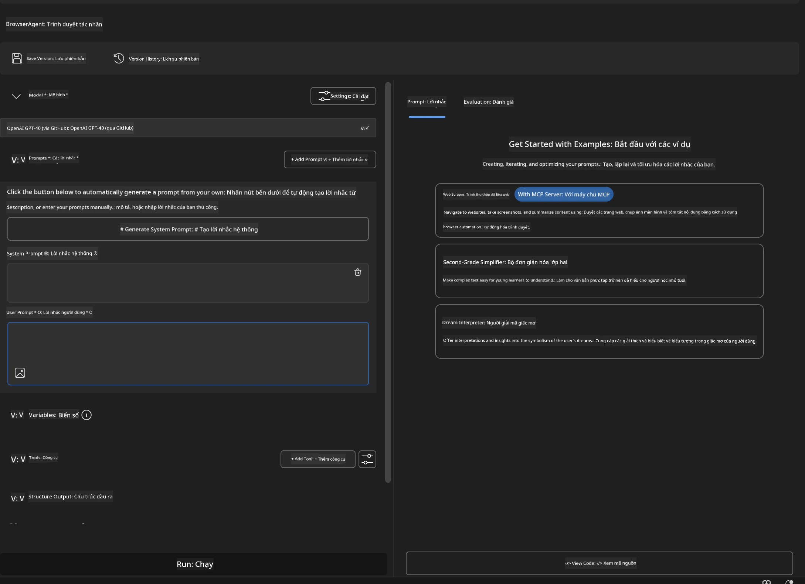

### 🔧 Giai Đoạn 2: Quy Trình Tích Hợp MCP

#### Bước 3: Thêm Tích Hợp Máy Chủ MCP

1. **Đi Tới Phần Công Cụ** trong Agent Builder
2. **Nhấn "Add Tool"** để mở menu tích hợp
3. **Chọn "MCP Server"** từ các tùy chọn có sẵn

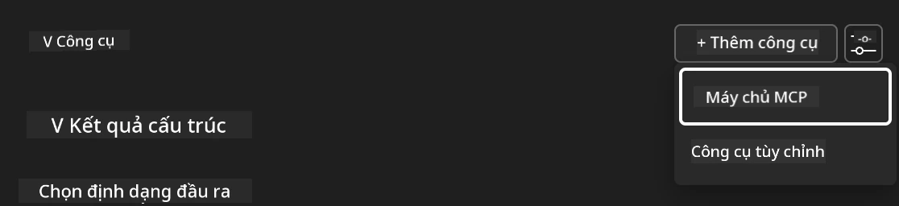

**🔍 Hiểu Về Các Loại Công Cụ:**

- **Công Cụ Tích Hợp Sẵn**: Các chức năng đã được cấu hình sẵn của Microsoft Foundry Toolkit
- **Máy Chủ MCP**: Tích hợp dịch vụ bên ngoài
- **API Tùy Chỉnh**: Điểm cuối dịch vụ của riêng bạn
- **Gọi Hàm**: Truy cập trực tiếp hàm mô hình

#### Bước 4: Chọn Máy Chủ MCP

1. **Chọn tùy chọn "MCP Server"** để tiếp tục
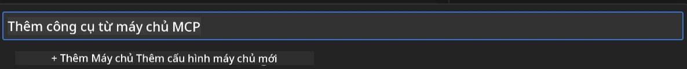

2. **Duyệt Catalog MCP** để khám phá các tích hợp có sẵn
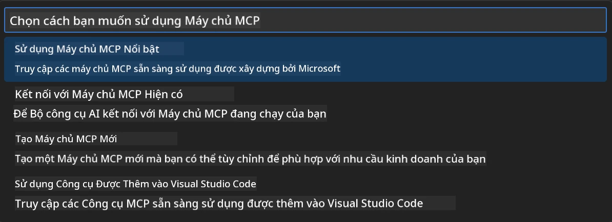

### 🎮 Giai Đoạn 3: Cấu Hình Playwright MCP

#### Bước 5: Chọn và Cấu Hình Playwright

1. **Nhấn "Use Featured MCP Servers"** để truy cập các máy chủ đã được Microsoft xác minh
2. **Chọn "Playwright"** từ danh sách nổi bật
3. **Chấp nhận MCP ID Mặc Định** hoặc tùy chỉnh cho môi trường của bạn

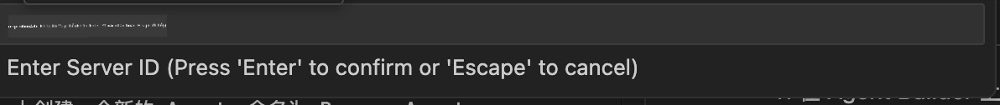

#### Bước 6: Kích Hoạt Các Khả Năng Playwright

**🔑 Bước Quan Trọng**: Chọn **TẤT CẢ** các phương thức Playwright có sẵn để có chức năng tối đa

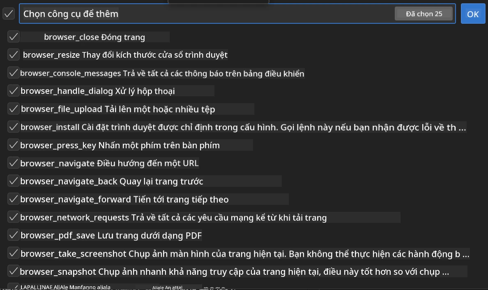

**🛠️ Các Công Cụ Cần Thiết của Playwright:**

- **Điều hướng**: `goto`, `goBack`, `goForward`, `reload`
- **Tương tác**: `click`, `fill`, `press`, `hover`, `drag`
- **Trích xuất**: `textContent`, `innerHTML`, `getAttribute`
- **Xác thực**: `isVisible`, `isEnabled`, `waitForSelector`
- **Chụp**: `screenshot`, `pdf`, `video`
- **Mạng**: `setExtraHTTPHeaders`, `route`, `waitForResponse`

#### Bước 7: Xác Nhận Tích Hợp Thành Công

**✅ Các Dấu Hiệu Thành Công:**

- Tất cả công cụ hiển thị trong giao diện Agent Builder
- Không có thông báo lỗi trong bảng tích hợp
- Trạng thái máy chủ Playwright hiển thị "Connected"

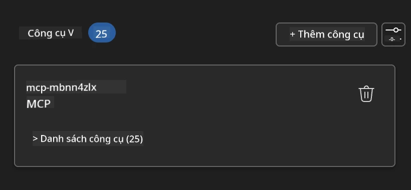

**🔧 Khắc Phục Các Vấn Đề Thường Gặp:**

- **Kết Nối Thất Bại**: Kiểm tra kết nối internet và cấu hình tường lửa
- **Thiếu Công Cụ**: Đảm bảo mọi khả năng đã được chọn trong quá trình thiết lập
- **Lỗi Quyền Truy Cập**: Xác minh VS Code có quyền hệ thống cần thiết

### 🎯 Giai Đoạn 4: Thiết Kế Prompt Nâng Cao

#### Bước 8: Thiết Kế Prompt Hệ Thống Thông Minh

Tạo các prompt tinh vi tận dụng tối đa khả năng của Playwright:

```markdown
# Web Automation Expert System Prompt

## Core Identity
You are an advanced web automation specialist with deep expertise in browser
automation, web scraping, and user experience analysis. You have access to
Playwright tools for comprehensive browser control.

## Capabilities & Approach
### Navigation Strategy
- Always start with screenshots to understand page layout
- Use semantic selectors (text content, labels) when possible
- Implement wait strategies for dynamic content
- Handle single-page applications (SPAs) effectively

### Error Handling
- Retry failed operations with exponential backoff
- Provide clear error descriptions and solutions
- Suggest alternative approaches when primary methods fail
- Always capture diagnostic screenshots on errors

### Data Extraction
- Extract structured data in JSON format when possible
- Provide confidence scores for extracted information
- Validate data completeness and accuracy
- Handle pagination and infinite scroll scenarios

### Reporting
- Include step-by-step execution logs
- Provide before/after screenshots for verification
- Suggest optimizations and alternative approaches
- Document any limitations or edge cases encountered

## Ethical Guidelines
- Respect robots.txt and rate limiting
- Avoid overloading target servers
- Only extract publicly available information
- Follow website terms of service
```

#### Bước 9: Tạo Prompt Người Dùng Động

Thiết kế các prompt thể hiện các khả năng khác nhau:

**🌐 Ví Dụ Phân Tích Web:**

```markdown
Navigate to github.com/kinfey and provide a comprehensive analysis including:
1. Repository structure and organization
2. Recent activity and contribution patterns  
3. Documentation quality assessment
4. Technology stack identification
5. Community engagement metrics
6. Notable projects and their purposes

Include screenshots at key steps and provide actionable insights.
```

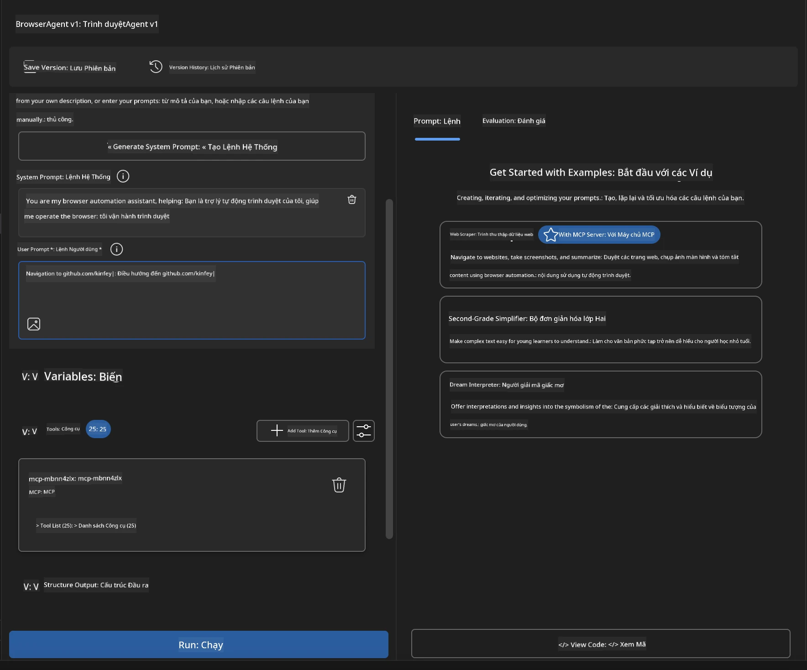

### 🚀 Giai Đoạn 5: Thực Thi và Kiểm Tra

#### Bước 10: Thực Thi Tự Động Hóa Đầu Tiên

1. **Nhấn "Run"** để bắt đầu chuỗi tự động hóa
2. **Giám sát Thực Thi Theo Thời Gian Thực**:
   - Trình duyệt Chrome tự động mở ra
   - Tác nhân điều hướng đến trang web mục tiêu
   - Chụp ảnh màn hình ở mỗi bước chính
   - Kết quả phân tích được truyền trực tiếp

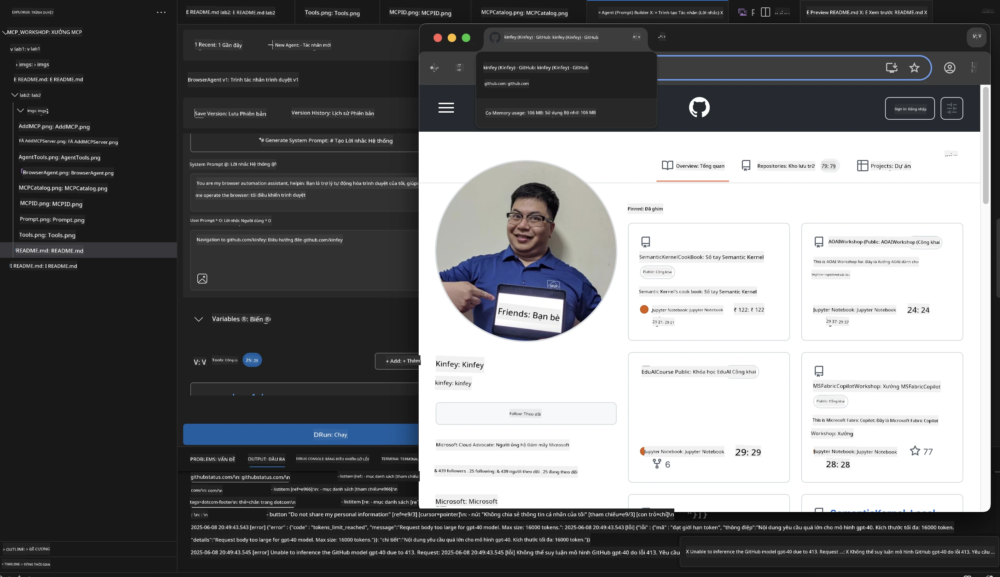

#### Bước 11: Phân Tích Kết Quả và Những Hiểu Biết

Xem phân tích toàn diện trong giao diện của Agent Builder:

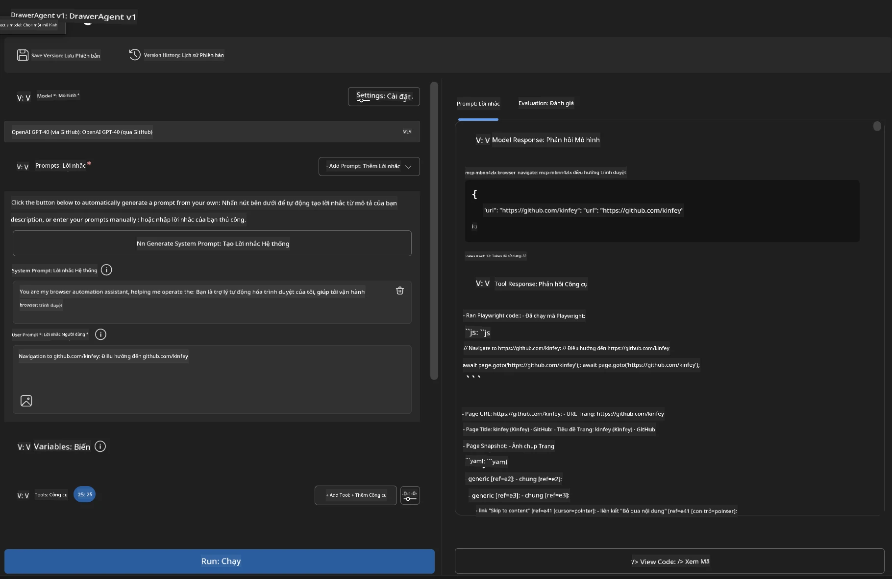

### 🌟 Giai Đoạn 6: Các Khả Năng Nâng Cao và Triển Khai

#### Bước 12: Xuất và Triển Khai Sản Xuất

Agent Builder hỗ trợ nhiều tùy chọn triển khai:

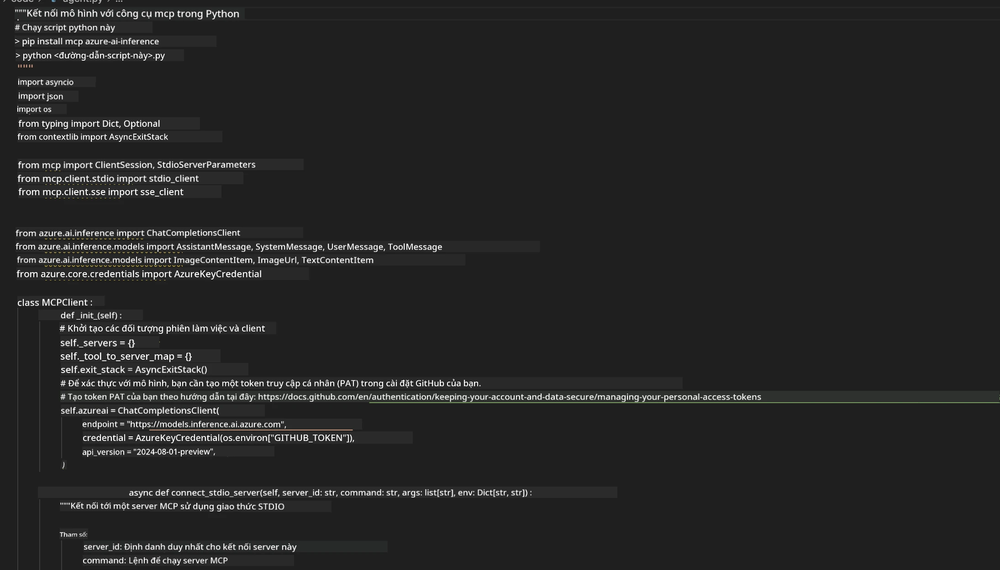

## 🎓 Tóm Tắt Module 2 & Các Bước Tiếp Theo

### 🏆 Thành Tựu Đạt Được: Thạc Sĩ Tích Hợp MCP

**✅ Kỹ Năng Đã Làm Chủ:**

- [ ] Hiểu kiến trúc và lợi ích MCP
- [ ] Điều hướng hệ sinh thái máy chủ MCP của Microsoft
- [ ] Tích hợp Playwright MCP với Microsoft Foundry Toolkit
- [ ] Xây dựng tác nhân tự động trình duyệt phức tạp
- [ ] Thiết kế prompt nâng cao cho tự động hóa web

### 📚 Tài Nguyên Bổ Sung

- **🔗 Đặc Tả MCP**: [Tài Liệu Giao Thức Chính Thức](https://modelcontextprotocol.io/)
- **🛠️ API Playwright**: [Tham Khảo Phương Thức Hoàn Chỉnh](https://playwright.dev/docs/api/class-playwright)
- **🏢 Máy Chủ MCP Microsoft**:
   [Hướng Dẫn Tích Hợp Doanh Nghiệp](https://github.com/microsoft/mcp-servers)
- **🌍 Ví Dụ Cộng Đồng**: [Bộ Sưu Tập Máy Chủ MCP](https://github.com/modelcontextprotocol/servers)

**🎉 Chúc mừng!** Bạn đã thành công làm chủ tích hợp MCP và giờ có thể
xây dựng các tác nhân AI sẵn sàng cho sản xuất với khả năng công cụ bên ngoài!

### 🔜 Tiếp Tục Sang Module Tiếp Theo

Sẵn sàng nâng cao kỹ năng MCP của bạn? Hãy tiếp tục tới
**[Module 3: Phát Triển MCP Nâng Cao với Microsoft Foundry Toolkit](../lab3/README.md)**
nơi bạn sẽ học cách:

- Tạo máy chủ MCP tùy chỉnh riêng của bạn
- Cấu hình và sử dụng SDK Python MCP mới nhất
- Cài đặt MCP Inspector để gỡ lỗi
- Làm chủ các quy trình phát triển máy chủ MCP nâng cao
- Xây dựng một Máy Chủ MCP Thời Tiết từ đầu

---

<!-- CO-OP TRANSLATOR DISCLAIMER START -->
**Tuyên bố miễn trừ trách nhiệm**:
Tài liệu này đã được dịch bằng dịch vụ dịch thuật AI [Co-op Translator](https://github.com/Azure/co-op-translator). Mặc dù chúng tôi cố gắng đảm bảo độ chính xác, xin lưu ý rằng bản dịch tự động có thể chứa lỗi hoặc sai sót. Tài liệu gốc bằng ngôn ngữ gốc nên được coi là nguồn tin chính thức. Đối với thông tin quan trọng, nên sử dụng dịch vụ dịch thuật chuyên nghiệp bởi con người. Chúng tôi không chịu trách nhiệm về bất kỳ hiểu lầm hoặc giải thích sai nào phát sinh từ việc sử dụng bản dịch này.
<!-- CO-OP TRANSLATOR DISCLAIMER END -->