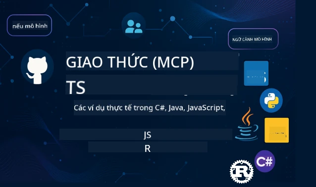

 

[](https://GitHub.com/microsoft/mcp-for-beginners/graphs/contributors)
[](https://GitHub.com/microsoft/mcp-for-beginners/issues)
[](https://GitHub.com/microsoft/mcp-for-beginners/pulls)
[](http://makeapullrequest.com)
[](https://mcptoplist.com/server/mcp.so%2Fmcp-for-beginners%2Fmicrosoft)

[](https://GitHub.com/microsoft/mcp-for-beginners/watchers)
[](https://GitHub.com/microsoft/mcp-for-beginners/fork)
[](https://GitHub.com/microsoft/mcp-for-beginners/stargazers)


[](https://discord.gg/nTYy5BXMWG)

Làm theo các bước này để bắt đầu sử dụng các tài nguyên này:
1. **Tạo Fork kho lưu trữ**: Nhấn vào [](https://GitHub.com/microsoft/mcp-for-beginners/fork)
2. **Clone kho lưu trữ**:   `git clone https://github.com/microsoft/mcp-for-beginners.git`
3. **Tham gia** [](https://discord.gg/nTYy5BXMWG)


### 🌐 Hỗ trợ đa ngôn ngữ

#### Bản dịch được duy trì với [Co-op Translator](https://github.com/Azure/co-op-translator)

<!-- CO-OP TRANSLATOR LANGUAGES TABLE START -->
[Arabic](../ar/README.md) | [Bengali](../bn/README.md) | [Bulgarian](../bg/README.md) | [Burmese (Myanmar)](../my/README.md) | [Chinese (Simplified)](../zh-CN/README.md) | [Chinese (Traditional, Hong Kong)](../zh-HK/README.md) | [Chinese (Traditional, Macau)](../zh-MO/README.md) | [Chinese (Traditional, Taiwan)](../zh-TW/README.md) | [Croatian](../hr/README.md) | [Czech](../cs/README.md) | [Danish](../da/README.md) | [Dutch](../nl/README.md) | [Estonian](../et/README.md) | [Finnish](../fi/README.md) | [French](../fr/README.md) | [German](../de/README.md) | [Greek](../el/README.md) | [Hebrew](../he/README.md) | [Hindi](../hi/README.md) | [Hungarian](../hu/README.md) | [Indonesian](../id/README.md) | [Italian](../it/README.md) | [Japanese](../ja/README.md) | [Kannada](../kn/README.md) | [Khmer](../km/README.md) | [Korean](../ko/README.md) | [Lithuanian](../lt/README.md) | [Malay](../ms/README.md) | [Malayalam](../ml/README.md) | [Manipuri (Meitei Mayek)](../mni/README.md) | [Marathi](../mr/README.md) | [Nepali](../ne/README.md) | [Nigerian Pidgin](../pcm/README.md) | [Norwegian](../no/README.md) | [Persian (Farsi)](../fa/README.md) | [Polish](../pl/README.md) | [Portuguese (Brazil)](../pt-BR/README.md) | [Portuguese (Portugal)](../pt-PT/README.md) | [Punjabi (Gurmukhi)](../pa/README.md) | [Romanian](../ro/README.md) | [Russian](../ru/README.md) | [Serbian (Cyrillic)](../sr/README.md) | [Slovak](../sk/README.md) | [Slovenian](../sl/README.md) | [Spanish](../es/README.md) | [Swahili](../sw/README.md) | [Swedish](../sv/README.md) | [Tagalog (Filipino)](../tl/README.md) | [Tamil](../ta/README.md) | [Telugu](../te/README.md) | [Thai](../th/README.md) | [Turkish](../tr/README.md) | [Ukrainian](../uk/README.md) | [Urdu](../ur/README.md) | [Vietnamese](./README.md)

> **Ưu tiên Clone ở máy tính của bạn?**
>
> Kho lưu trữ này bao gồm hơn 50 bản dịch ngôn ngữ, điều này làm tăng đáng kể kích thước tải xuống. Để clone mà không có bản dịch, hãy dùng sparse checkout:
>
> **Bash / macOS / Linux:**
> ```bash
> git clone --filter=blob:none --sparse https://github.com/microsoft/mcp-for-beginners.git
> cd mcp-for-beginners
> git sparse-checkout set --no-cone '/*' '!translations' '!translated_images'
> ```
>
> **CMD (Windows):**
> ```cmd
> git clone --filter=blob:none --sparse https://github.com/microsoft/mcp-for-beginners.git
> cd mcp-for-beginners
> git sparse-checkout set --no-cone "/*" "!translations" "!translated_images"
> ```
>
> Điều này cung cấp cho bạn mọi thứ cần thiết để hoàn thành khóa học với tốc độ tải xuống nhanh hơn nhiều.
<!-- CO-OP TRANSLATOR LANGUAGES TABLE END -->

# 🚀 Giáo trình Model Context Protocol (MCP) dành cho người mới bắt đầu

## **Học MCP với các ví dụ mã thực hành bằng C#, Java, JavaScript, Rust, Python và TypeScript**

## 🧠 Tổng quan về Giáo trình Model Context Protocol
Chào mừng bạn đến với hành trình khám phá Model Context Protocol! Nếu bạn từng tự hỏi ứng dụng AI giao tiếp với các công cụ và dịch vụ khác nhau như thế nào, bạn sắp được khám phá giải pháp tinh tế đang thay đổi cách các nhà phát triển xây dựng hệ thống thông minh.

Hãy nghĩ về MCP như một bộ dịch thuật chung cho các ứng dụng AI - giống như cách các cổng USB cho phép bạn kết nối bất kỳ thiết bị nào với máy tính, MCP cho phép các mô hình AI kết nối với bất kỳ công cụ hoặc dịch vụ nào theo cách chuẩn hóa. Cho dù bạn đang xây dựng chatbot đầu tiên hay làm việc trên các quy trình AI phức tạp, hiểu MCP sẽ giúp bạn tạo ra các ứng dụng linh hoạt và mạnh mẽ hơn.

Giáo trình này được thiết kế với sự kiên nhẫn và tận tâm cho hành trình học tập của bạn. Chúng ta sẽ bắt đầu với những khái niệm đơn giản mà bạn đã quen thuộc và dần dần xây dựng chuyên môn thông qua thực hành bằng tay với ngôn ngữ lập trình bạn thích. Mỗi bước đều có giải thích rõ ràng, ví dụ thực tế và nhiều sự khích lệ trên đường đi.

Khi bạn hoàn thành hành trình này, bạn sẽ có đủ tự tin để xây dựng các máy chủ MCP của riêng mình, tích hợp chúng với các nền tảng AI phổ biến và hiểu cách công nghệ này đang định hình tương lai phát triển AI. Hãy bắt đầu cuộc phiêu lưu thú vị này cùng nhau nào!

### Tài liệu và Thông số kỹ thuật chính thức

Phiên bản giao thức hiện tại là **Đặc tả MCP 2026-07-28**. Đặc tả MCP
sử dụng cách đặt phiên bản dựa trên ngày tháng (định dạng YYYY-MM-DD) để làm rõ
sự tương thích của giao thức.

> **Lưu ý phiên bản:** giáo trình này dạy các khái niệm `2026-07-28`
> hiện tại, bao gồm yêu cầu không trạng thái, khung Mở rộng, và
> việc loại bỏ Roots, Sampling, và Logging. Một số ví dụ thực hành vẫn được
> đánh số phiên bản rõ ràng theo `2025-11-25` trong khi SDK đang cập nhật. Xem
> [Điều gì đã thay đổi trong MCP: Đặc tả 2026-07-28](./01-CoreConcepts/mcp-2026-07-28.md)
> để biết những thay đổi và hướng dẫn chuyển đổi.

Những tài nguyên này càng trở nên giá trị khi bạn hiểu biết nhiều hơn, nhưng đừng cảm thấy áp lực phải đọc hết ngay lập tức. Hãy bắt đầu với những lĩnh vực bạn quan tâm nhất!
- 📘 [Tài liệu MCP](https://modelcontextprotocol.io/) – Đây là tài nguyên chính cho các bài hướng dẫn từng bước và hướng dẫn người dùng. Tài liệu được viết dành cho người mới, cung cấp các ví dụ rõ ràng để bạn có thể theo dõi theo tốc độ của riêng bạn.
- 📜 [Đặc tả MCP](https://modelcontextprotocol.io/specification/2026-07-28) – Hãy nghĩ đây là sổ tay tham khảo toàn diện. Khi làm qua giáo trình, bạn sẽ thường xuyên quay lại đây để tra cứu chi tiết và khám phá các tính năng nâng cao.
- 📜 [Đặt phiên bản Đặc tả MCP](https://modelcontextprotocol.io/specification/versioning) – Chứa thông tin về lịch sử phiên bản giao thức và cách MCP sử dụng cách đặt phiên bản dựa trên ngày tháng (định dạng YYYY-MM-DD).
- 🧑‍💻 [Kho lưu trữ MCP trên GitHub](https://github.com/modelcontextprotocol) – Tại đây bạn sẽ tìm thấy SDK, công cụ và ví dụ mã bằng nhiều ngôn ngữ lập trình. Đây như một kho tàng các ví dụ thực tiễn và các thành phần sẵn sàng sử dụng.
- 🌐 [Cộng đồng MCP](https://github.com/orgs/modelcontextprotocol/discussions) – Tham gia cùng những người học khác và các nhà phát triển giàu kinh nghiệm để thảo luận về MCP. Đây là cộng đồng hỗ trợ, nơi bạn có thể đặt câu hỏi và chia sẻ kiến thức một cách tự do.
  
## Mục tiêu học tập

Cuối giáo trình này, bạn sẽ cảm thấy tự tin và hào hứng với khả năng mới. Dưới đây là những gì bạn sẽ đạt được:

• **Hiểu các nguyên lý cơ bản của MCP**: Bạn sẽ nắm được Model Context Protocol là gì và tại sao nó đang cách mạng hoá cách các ứng dụng AI làm việc cùng nhau, với các phép ẩn dụ và ví dụ dễ hiểu.

• **Xây dựng máy chủ MCP đầu tiên của bạn**: Bạn sẽ tạo một máy chủ MCP hoạt động bằng ngôn ngữ lập trình bạn ưa thích, bắt đầu với các ví dụ đơn giản và phát triển kỹ năng từng bước.

• **Kết nối các mô hình AI với công cụ thực tế**: Bạn sẽ học cách liên kết mô hình AI với các dịch vụ thật, mang đến cho ứng dụng của bạn khả năng mạnh mẽ mới.

• **Áp dụng các thực tiễn bảo mật tốt nhất**: Bạn sẽ hiểu cách giữ an toàn cho các triển khai MCP, bảo vệ cả ứng dụng và người dùng.

• **Triển khai với sự tự tin**: Bạn sẽ biết cách đưa dự án MCP từ giai đoạn phát triển đến sản xuất, với các chiến lược triển khai thực tiễn hiệu quả.

• **Tham gia cộng đồng MCP**: Bạn sẽ trở thành thành viên của cộng đồng nhà phát triển ngày càng phát triển, những người đang hình thành tương lai phát triển ứng dụng AI.

## Kiến thức nền tảng thiết yếu

Trước khi đi vào chi tiết MCP, hãy đảm bảo bạn cảm thấy thoải mái với một vài khái niệm nền tảng. Đừng lo nếu bạn không phải chuyên gia trong những lĩnh vực này - chúng tôi sẽ giải thích mọi thứ bạn cần trong quá trình học!

### Hiểu giao thức (Nền tảng)

Hãy nghĩ giao thức như quy tắc cho một cuộc trò chuyện. Khi bạn gọi điện cho bạn bè, cả hai đều biết cách nói "xin chào" khi bắt máy, lần lượt nói chuyện và chào "tạm biệt" khi kết thúc. Các chương trình máy tính cũng cần quy tắc tương tự để giao tiếp hiệu quả.

MCP là một giao thức - tập hợp các quy tắc đồng thuận giúp các mô hình AI và ứng dụng có các "cuộc trò chuyện" hiệu quả với công cụ và dịch vụ. Cũng giống như có quy tắc trò chuyện giúp giao tiếp giữa người với người mượt mà hơn, MCP làm cho giao tiếp ứng dụng AI trở nên tin cậy và mạnh mẽ hơn nhiều.

### Mối quan hệ Client-Server (Cách các chương trình làm việc cùng nhau)

Bạn đã sử dụng mối quan hệ client-server hàng ngày rồi! Khi bạn dùng trình duyệt web (client) để truy cập một trang web, bạn đang kết nối tới máy chủ web để nhận nội dung trang. Trình duyệt biết cách yêu cầu thông tin, còn máy chủ biết cách phản hồi.

Trong MCP, chúng ta có mối quan hệ tương tự: các mô hình AI đóng vai trò như client yêu cầu thông tin hoặc hành động, còn máy chủ MCP cung cấp các khả năng đó. Nó giống như có một trợ lý hữu ích (máy chủ) mà AI có thể yêu cầu thực hiện các công việc cụ thể.

### Tại sao việc chuẩn hóa lại quan trọng (Làm cho mọi thứ hoạt động cùng nhau)

Hãy tưởng tượng nếu mỗi nhà sản xuất xe dùng bơm xăng hình dạng khác nhau - bạn sẽ cần một bộ chuyển đổi khác cho mỗi xe! Chuẩn hóa nghĩa là đồng ý về các phương pháp chung để mọi thứ hoạt động liền mạch.

MCP cung cấp sự chuẩn hóa này cho các ứng dụng AI. Thay vì mỗi mô hình AI cần mã tùy chỉnh để làm việc với từng công cụ, MCP tạo ra một cách chung để chúng giao tiếp. Điều này có nghĩa là các nhà phát triển có thể xây dựng công cụ một lần và cho phép chúng làm việc với nhiều hệ thống AI khác nhau.

## 🧭 Tổng quan lộ trình học tập của bạn

Hành trình MCP của bạn được cấu trúc cẩn thận để xây dựng sự tự tin và kỹ năng một cách tiến bộ. Mỗi giai đoạn giới thiệu các khái niệm mới đồng thời củng cố những gì bạn đã học.

### 🌱 Giai đoạn nền tảng: Hiểu các khái niệm cơ bản (Các module 0-2)

Đây là nơi cuộc phiêu lưu bắt đầu! Chúng tôi sẽ giới thiệu các khái niệm MCP bằng cách sử dụng phép ẩn dụ quen thuộc và các ví dụ đơn giản. Bạn sẽ hiểu MCP là gì, tại sao nó tồn tại, và nó phù hợp như thế nào trong thế giới phát triển AI rộng lớn hơn.

• **Module 0 - Giới thiệu về MCP**: Chúng ta sẽ bắt đầu bằng cách khám phá MCP là gì và tại sao nó quan trọng đối với các ứng dụng AI hiện đại. Bạn sẽ thấy các ví dụ thực tế về MCP hoạt động và hiểu cách nó giải quyết các vấn đề phổ biến mà các nhà phát triển gặp phải.

• **Module 1 - Giải thích các khái niệm cốt lõi**: Ở đây bạn sẽ học các khối xây dựng thiết yếu của MCP. Chúng tôi dùng nhiều phép ẩn dụ và ví dụ minh họa để đảm bảo các khái niệm này trở nên tự nhiên và dễ hiểu.

• **Module 2 - Bảo mật trong MCP**: Bảo mật nghe có vẻ đáng sợ, nhưng chúng tôi sẽ cho bạn thấy MCP bao gồm các tính năng an toàn tích hợp và dạy bạn các thực tiễn tốt nhất để bảo vệ ứng dụng của bạn ngay từ đầu.

### 🔨 Giai đoạn xây dựng: Tạo ra các triển khai đầu tiên của bạn (Module 3)

Bây giờ phần thú vị thực sự bắt đầu! Bạn sẽ có trải nghiệm thực hành xây dựng các máy chủ và client MCP thực tế. Đừng lo - chúng tôi sẽ bắt đầu đơn giản và hướng dẫn bạn từng bước một.

Module này bao gồm nhiều hướng dẫn thực hành giúp bạn luyện tập bằng ngôn ngữ lập trình ưa thích của mình. Bạn sẽ tạo server đầu tiên, xây dựng client để kết nối với nó, và thậm chí tích hợp với các công cụ phát triển phổ biến như VS Code.

Mỗi hướng dẫn bao gồm các ví dụ mã đầy đủ, mẹo khắc phục sự cố, và giải thích lý do tại sao chúng tôi chọn các thiết kế cụ thể. Kết thúc giai đoạn này, bạn sẽ có các triển khai MCP hoạt động mà bạn có thể tự hào!

### 🚀 Giai đoạn Phát triển: Khái niệm nâng cao và Ứng dụng thực tiễn (Các Module 4-5)

Khi đã thành thạo kiến thức cơ bản, bạn sẵn sàng khám phá các tính năng MCP tinh vi hơn. Chúng tôi sẽ đề cập đến các chiến lược triển khai thực tế, kỹ thuật gỡ lỗi, và các chủ đề nâng cao như tích hợp AI đa phương thức.

Bạn cũng sẽ học cách mở rộng các triển khai MCP để sử dụng cho sản xuất và tích hợp với các nền tảng đám mây như Azure. Những module này chuẩn bị cho bạn xây dựng các giải pháp MCP có thể đáp ứng yêu cầu thực tế.

### 🌟 Giai đoạn Thành thạo: Cộng đồng và Chuyên môn hóa (Các Module 6-11)

Giai đoạn cuối tập trung vào việc tham gia cộng đồng MCP và chuyên sâu vào các lĩnh vực bạn quan tâm nhất. Bạn sẽ học cách đóng góp cho các dự án MCP mã nguồn mở, triển khai các mẫu xác thực nâng cao, và xây dựng các giải pháp tích hợp cơ sở dữ liệu toàn diện.

Module 11 xứng đáng được nhắc đến đặc biệt - là một lộ trình học tập thực hành hoàn chỉnh gồm 13 phòng lab dạy bạn xây dựng các server MCP sẵn sàng cho sản xuất với tích hợp PostgreSQL. Nó như một dự án tổng kết gộp tất cả những gì bạn đã học!

### 📚 Cấu trúc Khóa học đầy đủ

| Module | Chủ đề | Mô tả | Liên kết |
|--------|-------|--------|------|
| **Module 0-3: Kiến thức cơ bản** | | | |
| 00 | Giới thiệu về MCP | Tổng quan Model Context Protocol và tầm quan trọng của nó trong các pipeline AI | [Đọc thêm](./00-Introduction/README.md) |
| 01 | Giải thích các khái niệm cốt lõi | Khám phá sâu các khái niệm MCP cốt lõi | [Đọc thêm](./01-CoreConcepts/README.md) |
| 1.1 | Những thay đổi trong MCP (2026-07-28) | Giao thức không trạng thái, khung Extensions, và các tính năng bị loại bỏ trong đặc tả hiện tại | [Hướng dẫn](./01-CoreConcepts/mcp-2026-07-28.md) |
| 02 | An ninh trong MCP | Các mối đe dọa bảo mật và thực hành tốt nhất | [Đọc thêm](./02-Security/README.md) |
| 2.1 | Ủy quyền CIMD và DCR | So sánh đăng ký CIMD ưu tiên với phương án dự phòng DCR bị loại bỏ dùng server MCP được bảo vệ | [Mẫu](./02-Security/samples/cimd-dcr-auth/README.md) |
| 03 | Bắt đầu với MCP | Thiết lập môi trường, server/client cơ bản, tích hợp | [Đọc thêm](./03-GettingStarted/README.md) |
| **Module 3: Xây dựng Server & Client đầu tiên của bạn** | | | |
| 3.1 | Server đầu tiên | Tạo server MCP đầu tiên của bạn | [Hướng dẫn](./03-GettingStarted/01-first-server/README.md) |
| 3.2 | Client đầu tiên | Phát triển client MCP cơ bản | [Hướng dẫn](./03-GettingStarted/02-client/README.md) |
| 3.3 | Client với LLM | Tích hợp các mô hình ngôn ngữ lớn | [Hướng dẫn](./03-GettingStarted/03-llm-client/README.md) |
| 3.4 | Tích hợp VS Code | Tiêu thụ các server MCP trong VS Code | [Hướng dẫn](./03-GettingStarted/04-vscode/README.md) |
| 3.5 | Server stdio | Tạo server sử dụng truyền tải stdio | [Hướng dẫn](./03-GettingStarted/05-stdio-server/README.md) |
| 3.6 | Streaming HTTP | Triển khai streaming HTTP trong MCP | [Hướng dẫn](./03-GettingStarted/06-http-streaming/README.md) |
| 3.7 | Bộ công cụ Microsoft Foundry | Sử dụng Microsoft Foundry Toolkit với MCP | [Hướng dẫn](./03-GettingStarted/07-aitk/README.md) |
| 3.8 | Kiểm thử | Kiểm thử triển khai server MCP của bạn | [Hướng dẫn](./03-GettingStarted/08-testing/README.md) |
| 3.9 | Triển khai | Triển khai server MCP lên môi trường sản xuất | [Hướng dẫn](./03-GettingStarted/09-deployment/README.md) |
| 3.10 | Sử dụng server nâng cao | Dùng các server nâng cao cho tính năng nâng cao và kiến trúc cải tiến | [Hướng dẫn](./03-GettingStarted/10-advanced/README.md) |
| 3.11 | Xác thực đơn giản | Chương trình giới thiệu xác thực từ đầu và RBAC | [Hướng dẫn](./03-GettingStarted/11-simple-auth/README.md) |
| 3.12 | MCP Hosts | Cấu hình Claude Desktop, Cursor, Cline và các MCP hosts khác | [Hướng dẫn](./03-GettingStarted/12-mcp-hosts/README.md) |
| 3.13 | MCP Inspector | Gỡ lỗi và kiểm thử server MCP với công cụ Inspector | [Hướng dẫn](./03-GettingStarted/13-mcp-inspector/README.md) |
| 3.14 | Sampling | Sử dụng sampling để cộng tác với client | [Hướng dẫn](./03-GettingStarted/14-sampling/README.md) |
| 3.15 | MCP Apps | Xây dựng ứng dụng MCP | [Hướng dẫn](./03-GettingStarted/15-mcp-apps/README.md) |
| **Module 4-5: Thực tiễn & Nâng cao** | | | |
| 04 | Triển khai thực tế | SDKs, gỡ lỗi, kiểm thử, mẫu prompt tái sử dụng | [Đọc thêm](./04-PracticalImplementation/README.md) |
| 4.1 | Phân trang | Xử lý tập kết quả lớn với phân trang theo con trỏ | [Hướng dẫn](./04-PracticalImplementation/pagination/README.md) |
| 05 | Chủ đề nâng cao trong MCP | AI đa phương thức, mở rộng, sử dụng doanh nghiệp | [Đọc thêm](./05-AdvancedTopics/README.md) |
| 5.1 | Tích hợp Azure | Tích hợp MCP với Azure | [Hướng dẫn](./05-AdvancedTopics/mcp-integration/README.md) |
| 5.2 | Đa phương thức | Làm việc với nhiều phương thức | [Hướng dẫn](./05-AdvancedTopics/mcp-multi-modality/README.md) |
| 5.3 | Demo OAuth2 | Triển khai xác thực OAuth2 | [Hướng dẫn](./05-AdvancedTopics/mcp-oauth2-demo/README.md) |
| 5.4 | Context gốc | Hiểu và triển khai root contexts | [Hướng dẫn](./05-AdvancedTopics/mcp-root-contexts/README.md) |
| 5.5 | Định tuyến | Chiến lược định tuyến MCP | [Hướng dẫn](./05-AdvancedTopics/mcp-routing/README.md) |
| 5.6 | Sampling | Kỹ thuật sampling trong MCP | [Hướng dẫn](./05-AdvancedTopics/mcp-sampling/README.md) |
| 5.7 | Mở rộng quy mô | Mở rộng các triển khai MCP | [Hướng dẫn](./05-AdvancedTopics/mcp-scaling/README.md) |
| 5.8 | An ninh | Cân nhắc bảo mật nâng cao | [Hướng dẫn](./05-AdvancedTopics/mcp-security/README.md) |
| 5.9 | Tìm kiếm web | Triển khai khả năng tìm kiếm web | [Hướng dẫn](./05-AdvancedTopics/web-search-mcp/README.md) |
| 5.10 | Streaming thời gian thực | Xây dựng chức năng streaming thời gian thực | [Hướng dẫn](./05-AdvancedTopics/mcp-realtimestreaming/README.md) |
| 5.11 | Tìm kiếm thời gian thực | Triển khai tìm kiếm thời gian thực | [Hướng dẫn](./05-AdvancedTopics/mcp-realtimesearch/README.md) |
| 5.12 | Xác thực Entra ID | Xác thực với Microsoft Entra ID | [Hướng dẫn](./05-AdvancedTopics/mcp-security-entra/README.md) |
| 5.13 | Tích hợp Foundry | Tích hợp với Microsoft Foundry | [Hướng dẫn](./05-AdvancedTopics/mcp-foundry-agent-integration/README.md) |
| 5.14 | Kỹ thuật Context | Kỹ thuật cho kỹ thuật context hiệu quả | [Hướng dẫn](./05-AdvancedTopics/mcp-contextengineering/README.md) |
| 5.15 | Giao thức Transport tùy chỉnh MCP | Triển khai Transport tùy chỉnh | [Hướng dẫn](./05-AdvancedTopics/mcp-transport/README.md) |
| 5.16 | Tính năng giao thức | Thông báo tiến độ, hủy bỏ, mẫu tài nguyên | [Hướng dẫn](./05-AdvancedTopics/mcp-protocol-features/README.md) |
| 5.17 | Lý luận đa tác nhân đối kháng | Hai tác nhân tranh luận hai phía đối lập dùng công cụ MCP chia sẻ, được đánh giá bởi tác nhân trọng tài | [Hướng dẫn](./05-AdvancedTopics/mcp-adversarial-agents/README.md) |
| **Module 6-10: Cộng đồng & Thực hành tốt nhất** | | | |
| 06 | Đóng góp cộng đồng | Cách đóng góp cho hệ sinh thái MCP | [Hướng dẫn](./06-CommunityContributions/README.md) |
| 07 | Những hiểu biết từ áp dụng sớm | Các câu chuyện triển khai thực tế | [Hướng dẫn](./07-LessonsfromEarlyAdoption/README.md) |
| 08 | Thực hành tốt nhất cho MCP | Hiệu suất, chịu lỗi, độ bền bỉ | [Hướng dẫn](./08-BestPractices/README.md) |
| 09 | Nghiên cứu tình huống MCP | Ví dụ triển khai thực tiễn | [Hướng dẫn](./09-CaseStudy/README.md) |
| 10 | Hội thảo thực hành | Xây dựng MCP Server với Microsoft Foundry Toolkit | [Lab](./10-StreamliningAIWorkflowsBuildingAnMCPServerWithAIToolkit/README.md) |
| **Module 11: Phòng lab Thực hành MCP Server** | | | |
| 11 | Tích hợp cơ sở dữ liệu MCP Server | Lộ trình học thực hành 13 lab toàn diện về tích hợp PostgreSQL | [Labs](./11-MCPServerHandsOnLabs/README.md) |
| 11.1 | Giới thiệu | Tổng quan MCP với tích hợp cơ sở dữ liệu và trường hợp phân tích bán lẻ | [Lab 00](./11-MCPServerHandsOnLabs/00-Introduction/README.md) |
| 11.2 | Kiến trúc cốt lõi | Hiểu kiến trúc server MCP, lớp cơ sở dữ liệu, và mẫu bảo mật | [Lab 01](./11-MCPServerHandsOnLabs/01-Architecture/README.md) |
| 11.3 | Bảo mật & Đa tenancy | Bảo mật mức dòng, xác thực, và truy cập dữ liệu đa thuê | [Lab 02](./11-MCPServerHandsOnLabs/02-Security/README.md) |
| 11.4 | Thiết lập môi trường | Thiết lập môi trường phát triển, Docker, tài nguyên Azure | [Lab 03](./11-MCPServerHandsOnLabs/03-Setup/README.md) |
| 11.5 | Thiết kế cơ sở dữ liệu | Thiết lập PostgreSQL, thiết kế schema bán lẻ, và dữ liệu mẫu | [Lab 04](./11-MCPServerHandsOnLabs/04-Database/README.md) |
| 11.6 | Triển khai MCP Server | Xây dựng server FastMCP với tích hợp cơ sở dữ liệu | [Lab 05](./11-MCPServerHandsOnLabs/05-MCP-Server/README.md) |
| 11.7 | Phát triển công cụ | Tạo công cụ truy vấn cơ sở dữ liệu và khám phá schema | [Lab 06](./11-MCPServerHandsOnLabs/06-Tools/README.md) |
| 11.8 | Tìm kiếm ngữ nghĩa | Triển khai vector embeddings với Azure OpenAI và pgvector | [Lab 07](./11-MCPServerHandsOnLabs/07-Semantic-Search/README.md) |
| 11.9 | Kiểm thử & Gỡ lỗi | Chiến lược kiểm thử, công cụ gỡ lỗi và phương pháp xác thực | [Lab 08](./11-MCPServerHandsOnLabs/08-Testing/README.md) |
| 11.10 | Tích hợp VS Code | Cấu hình tích hợp MCP trong VS Code và sử dụng AI Chat | [Lab 09](./11-MCPServerHandsOnLabs/09-VS-Code/README.md) |
| 11.11 | Chiến lược triển khai | Triển khai Docker, Azure Container Apps và cân nhắc mở rộng | [Lab 10](./11-MCPServerHandsOnLabs/10-Deployment/README.md) |
| 11.12 | Giám sát | Application Insights, ghi nhật ký, giám sát hiệu suất | [Lab 11](./11-MCPServerHandsOnLabs/11-Monitoring/README.md) |
| 11.13 | Thực hành tốt nhất | Tối ưu hiệu suất, tăng cường bảo mật, và mẹo sản xuất | [Lab 12](./11-MCPServerHandsOnLabs/12-Best-Practices/README.md) |
| **Module 12: Công cụ MCP** | | | |
| 12.1 | Công cụ | Sử dụng MCP trong ứng dụng Copilot | [ Hướng dẫn ](./12-tooling/README.md) |

### 💻 Các dự án mã mẫu

Một trong những phần thú vị nhất của việc học MCP là thấy kỹ năng mã hóa của bạn phát triển dần dần. Chúng tôi đã thiết kế các ví dụ mã để bắt đầu đơn giản và trở nên phức tạp hơn khi bạn thấu hiểu sâu hơn. Dưới đây là cách chúng tôi giới thiệu các khái niệm - với mã dễ hiểu nhưng thể hiện các nguyên tắc MCP thực sự, bạn sẽ hiểu không chỉ mã làm gì mà còn tại sao nó được cấu trúc như vậy và nó phù hợp thế nào trong các ứng dụng MCP lớn hơn.

#### Các mẫu Máy tính MCP cơ bản

| Ngôn ngữ | Mô tả | Liên kết |
|----------|-------------|------|
| C# | Ví dụ Server MCP | [Xem mã](./03-GettingStarted/samples/csharp/README.md) |
| Java | Máy tính MCP | [Xem mã](./03-GettingStarted/samples/java/calculator/README.md) |
| JavaScript | Demo MCP | [Xem mã](./03-GettingStarted/samples/javascript/README.md) |
| Python | Server MCP | [Xem mã](../../03-GettingStarted/samples/python/mcp_calculator_server.py) |
| TypeScript | Ví dụ MCP | [Xem mã](./03-GettingStarted/samples/typescript/README.md) |
| Rust | Ví dụ MCP | [Xem mã](./03-GettingStarted/samples/rust/README.md) |

#### Các triển khai MCP nâng cao

| Ngôn ngữ | Mô tả | Liên kết |
|----------|-------------|------|
| C# | Mẫu nâng cao | [Xem mã](./04-PracticalImplementation/samples/csharp/README.md) |
| Java với Spring | Ví dụ Container App | [Xem mã](./04-PracticalImplementation/samples/java/containerapp/README.md) |
| JavaScript | Mẫu nâng cao | [Xem mã](./04-PracticalImplementation/samples/javascript/README.md) |
| Python | Triển khai phức tạp | [Xem mã](./04-PracticalImplementation/samples/python/README.md) |
| TypeScript | Mẫu Container | [Xem mã](./04-PracticalImplementation/samples/typescript/README.md) |


## 🎯 Yêu cầu tiên quyết để học MCP

Để tận dụng tốt nhất khóa học này, bạn nên có:

- Kiến thức cơ bản về lập trình ít nhất một trong các ngôn ngữ sau: C#, Java, JavaScript, Python hoặc TypeScript
- Hiểu biết về mô hình client-server và API
- Quen thuộc với REST và các khái niệm HTTP
- (Tùy chọn) Nền tảng về các khái niệm AI/ML

- Tham gia thảo luận cộng đồng của chúng tôi để nhận hỗ trợ

## 📚 Hướng dẫn học & Tài nguyên

Kho lưu trữ này bao gồm một số tài nguyên để giúp bạn điều hướng và học hiệu quả:

### Hướng dẫn học

Một [Hướng dẫn học](./study_guide.md) toàn diện có sẵn để giúp bạn điều hướng kho lưu trữ này hiệu quả. Bản đồ chương trình học trực quan này thể hiện cách tất cả các chủ đề kết nối và cung cấp hướng dẫn cách sử dụng các dự án mẫu hiệu quả. Nó đặc biệt hữu ích nếu bạn là người học trực quan thích nhìn thấy bức tranh tổng thể.

Hướng dẫn bao gồm:
- Bản đồ chương trình học trực quan hiển thị tất cả các chủ đề được bao phủ
- Phân tích chi tiết từng phần của kho lưu trữ
- Hướng dẫn cách sử dụng các dự án mẫu
- Các lộ trình học tập được đề xuất cho các cấp độ kỹ năng khác nhau
- Tài nguyên bổ sung để hỗ trợ hành trình học tập của bạn

### Nhật ký thay đổi

Chúng tôi duy trì một [Nhật ký thay đổi](./changelog.md) chi tiết theo dõi tất cả các cập nhật quan trọng của tài liệu chương trình học, để bạn có thể cập nhật các cải tiến và bổ sung mới nhất.
- Thêm nội dung mới
- Thay đổi cấu trúc
- Cải tiến tính năng
- Cập nhật tài liệu

## 🛠️ Cách sử dụng hiệu quả chương trình học này

Mỗi bài học trong hướng dẫn này bao gồm:

1. Giải thích rõ ràng các khái niệm MCP  
2. Ví dụ mã trực tiếp bằng nhiều ngôn ngữ  
3. Bài tập để xây dựng các ứng dụng MCP thực tế  
4. Tài nguyên bổ sung cho người học nâng cao

## 🎓 Hành trình MCP của bạn bắt đầu

Chúc mừng! Bạn vừa thực hiện bước đầu tiên trong một hành trình thú vị sẽ mở rộng khả năng lập trình và kết nối bạn với công nghệ AI tiên tiến nhất.

### Những gì bạn đã đạt được

Bằng cách đọc phần giới thiệu này, bạn đã bắt đầu xây dựng nền tảng kiến thức MCP. Bạn hiểu MCP là gì, tại sao nó quan trọng, và chương trình học này sẽ hỗ trợ hành trình học tập của bạn như thế nào. Đó là một thành tựu đáng kể và là khởi đầu cho chuyên môn của bạn trong công nghệ quan trọng này.

### Cuộc phiêu lưu phía trước

Khi bạn tiến bộ qua các mô-đun, hãy nhớ rằng bất kỳ chuyên gia nào cũng từng là người mới bắt đầu. Các khái niệm có thể có vẻ phức tạp bây giờ sẽ trở thành bản năng thứ hai khi bạn luyện tập và áp dụng chúng. Mỗi bước nhỏ góp phần xây dựng các khả năng mạnh mẽ sẽ phục vụ bạn suốt sự nghiệp phát triển.

### Mạng lưới hỗ trợ của bạn

Bạn đang tham gia vào một cộng đồng những người học và chuyên gia đam mê MCP và nhiệt tình giúp đỡ người khác thành công. Cho dù bạn đang gặp khó khăn với một thử thách mã hóa hay hào hứng chia sẻ một phát hiện mới, cộng đồng luôn ở đây để hỗ trợ bạn trên hành trình.

Nếu bạn gặp khó khăn hoặc có bất kỳ câu hỏi nào về việc xây dựng các ứng dụng AI, hãy tham gia cùng các học viên và nhà phát triển kinh nghiệm trong các cuộc thảo luận về MCP. Đây là một cộng đồng hỗ trợ, nơi các câu hỏi luôn được chào đón và kiến thức được chia sẻ tự do.

[](https://discord.gg/nTYy5BXMWG)

Nếu bạn có phản hồi về sản phẩm hoặc lỗi khi xây dựng, hãy truy cập:

[](https://aka.ms/foundry/forum)

### Sẵn sàng bắt đầu?

Hành trình MCP của bạn bắt đầu ngay bây giờ! Bắt đầu với Mô-đun 0 để khám phá trải nghiệm MCP thực hành đầu tiên của bạn, hoặc khám phá các dự án mẫu để xem bạn sẽ xây dựng những gì. Hãy nhớ - mọi chuyên gia đều bắt đầu chính xác từ vị trí của bạn lúc này, và với sự kiên nhẫn và luyện tập, bạn sẽ kinh ngạc về những gì mình có thể đạt được.

Chào mừng đến với thế giới phát triển Giao thức Ngữ cảnh Mô hình. Hãy cùng nhau tạo ra điều gì đó tuyệt vời!

## 🤝 Đóng góp cho cộng đồng học tập

Chương trình học này sẽ mạnh mẽ hơn nhờ những đóng góp từ những người học như bạn! Dù bạn sửa lỗi chính tả, đề xuất cách giải thích rõ ràng hơn, hay thêm một ví dụ mới, những đóng góp của bạn giúp những người mới bắt đầu khác thành công.

Cảm ơn Chuyên gia Được Đánh Giá của Microsoft [Shivam Goyal](https://www.linkedin.com/in/shivam2003/) đã đóng góp các mẫu mã.

Quy trình đóng góp được thiết kế thân thiện và hỗ trợ. Hầu hết các đóng góp yêu cầu Thỏa thuận Giấy phép Người đóng góp (CLA), nhưng các công cụ tự động sẽ hướng dẫn bạn qua quy trình một cách suôn sẻ.

## 📜 Học tập mã nguồn mở

Toàn bộ chương trình học này được cung cấp theo giấy phép MIT [LICENSE](../../LICENSE), có nghĩa là bạn có thể sử dụng, chỉnh sửa và chia sẻ tự do. Điều này hỗ trợ sứ mệnh giúp kiến thức MCP tiếp cận được với các nhà phát triển ở mọi nơi.
## 🤝 Hướng dẫn đóng góp

Dự án này chào đón các đóng góp và đề xuất. Hầu hết các đóng góp yêu cầu bạn đồng ý với
Thỏa thuận Giấy phép Người đóng góp (CLA) tuyên bố rằng bạn có quyền, và thực sự cấp cho chúng tôi
quyền sử dụng đóng góp của bạn. Chi tiết xem tại <https://cla.opensource.microsoft.com>.

Khi bạn gửi yêu cầu kéo, một bot CLA sẽ tự động xác định xem bạn có cần cung cấp
CLA hay không và trang trí PR cho phù hợp (ví dụ: kiểm tra trạng thái, bình luận). Chỉ cần làm theo hướng dẫn
do bot cung cấp. Bạn chỉ cần làm việc này một lần cho tất cả các kho sử dụng CLA của chúng tôi.

Dự án này đã áp dụng [Bộ Quy tắc Ứng xử Mã nguồn Mở Microsoft](https://opensource.microsoft.com/codeofconduct/).
Để biết thêm thông tin, xem [Câu hỏi thường gặp về Bộ Quy tắc Ứng xử](https://opensource.microsoft.com/codeofconduct/faq/) hoặc
liên hệ [opencode@microsoft.com](mailto:opencode@microsoft.com) với bất kỳ câu hỏi hoặc nhận xét bổ sung nào.

---

*Sẵn sàng bắt đầu hành trình MCP của bạn? Hãy bắt đầu với [Mô-đun 00 - Giới thiệu về MCP](./00-Introduction/README.md) và thực hiện những bước đầu tiên trên con đường phát triển Giao thức Ngữ cảnh Mô hình!*


## 🎒 Các khóa học khác
Nhóm chúng tôi cũng sản xuất các khóa học khác! Hãy xem:

<!-- CO-OP TRANSLATOR OTHER COURSES START -->
### LangChain
[](https://aka.ms/langchain4j-for-beginners)
[](https://aka.ms/langchainjs-for-beginners?WT.mc_id=m365-94501-dwahlin)
[](https://github.com/microsoft/langchain-for-beginners?WT.mc_id=m365-94501-dwahlin)
---

### Azure / Edge / MCP / Agents
[](https://github.com/microsoft/AZD-for-beginners?WT.mc_id=academic-105485-koreyst)
[](https://github.com/microsoft/edgeai-for-beginners?WT.mc_id=academic-105485-koreyst)
[](https://github.com/microsoft/mcp-for-beginners?WT.mc_id=academic-105485-koreyst)
[](https://github.com/microsoft/ai-agents-for-beginners?WT.mc_id=academic-105485-koreyst)

---
 
### Chuỗi AI Tạo sinh
[](https://github.com/microsoft/generative-ai-for-beginners?WT.mc_id=academic-105485-koreyst)
[-9333EA?style=for-the-badge&labelColor=E5E7EB&color=9333EA)](https://github.com/microsoft/Generative-AI-for-beginners-dotnet?WT.mc_id=academic-105485-koreyst)
[-C084FC?style=for-the-badge&labelColor=E5E7EB&color=C084FC)](https://github.com/microsoft/generative-ai-for-beginners-java?WT.mc_id=academic-105485-koreyst)
[-E879F9?style=for-the-badge&labelColor=E5E7EB&color=E879F9)](https://github.com/microsoft/generative-ai-with-javascript?WT.mc_id=academic-105485-koreyst)

---
 
### Học tập cốt lõi
[](https://aka.ms/ml-beginners?WT.mc_id=academic-105485-koreyst)
[](https://aka.ms/datascience-beginners?WT.mc_id=academic-105485-koreyst)
[](https://aka.ms/ai-beginners?WT.mc_id=academic-105485-koreyst)
[](https://github.com/microsoft/Security-101?WT.mc_id=academic-96948-sayoung)
[](https://aka.ms/webdev-beginners?WT.mc_id=academic-105485-koreyst)
[](https://aka.ms/iot-beginners?WT.mc_id=academic-105485-koreyst)
[](https://github.com/microsoft/xr-development-for-beginners?WT.mc_id=academic-105485-koreyst)

---
 
### Chuỗi Copilot
[](https://aka.ms/GitHubCopilotAI?WT.mc_id=academic-105485-koreyst)
[](https://github.com/microsoft/mastering-github-copilot-for-dotnet-csharp-developers?WT.mc_id=academic-105485-koreyst)
[](https://github.com/microsoft/CopilotAdventures?WT.mc_id=academic-105485-koreyst)
<!-- CO-OP TRANSLATOR OTHER COURSES END -->

---

<!-- CO-OP TRANSLATOR DISCLAIMER START -->
**Tuyên bố miễn trừ trách nhiệm**:
Tài liệu này đã được dịch bằng dịch vụ dịch thuật AI [Co-op Translator](https://github.com/Azure/co-op-translator). Mặc dù chúng tôi cố gắng đảm bảo độ chính xác, xin lưu ý rằng bản dịch tự động có thể chứa lỗi hoặc sai sót. Tài liệu gốc bằng ngôn ngữ gốc nên được coi là nguồn tin chính thức. Đối với thông tin quan trọng, nên sử dụng dịch vụ dịch thuật chuyên nghiệp bởi con người. Chúng tôi không chịu trách nhiệm về bất kỳ hiểu lầm hoặc giải thích sai nào phát sinh từ việc sử dụng bản dịch này.
<!-- CO-OP TRANSLATOR DISCLAIMER END -->