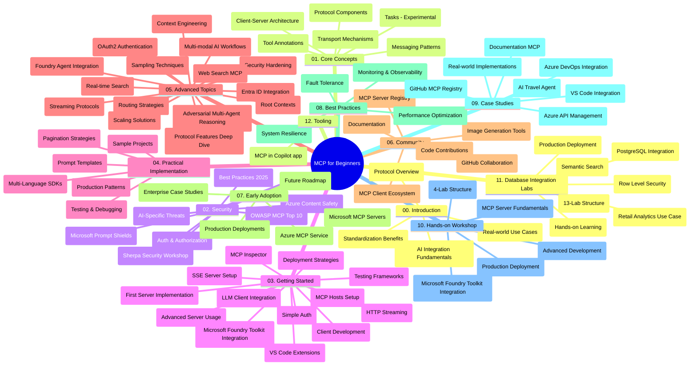

# Giao Thức Ngữ Cảnh Mô Hình (MCP) cho Người Mới Bắt Đầu - Hướng Dẫn Học Tập

Hướng dẫn học tập này cung cấp tổng quan về cấu trúc và nội dung kho lưu trữ cho chương trình "Giao Thức Ngữ Cảnh Mô Hình (MCP) cho Người Mới Bắt Đầu". Sử dụng hướng dẫn này để điều hướng kho lưu trữ một cách hiệu quả và tận dụng tối đa các tài nguyên có sẵn.

## Tổng Quan Kho Lưu Trữ

Giao Thức Ngữ Cảnh Mô Hình (MCP) là một khung chuẩn hóa cho các tương tác giữa các mô hình AI và các ứng dụng khách. Ban đầu được tạo bởi Anthropic, MCP hiện được cộng đồng MCP rộng lớn duy trì thông qua tổ chức chính thức trên GitHub. Kho lưu trữ này cung cấp một chương trình học toàn diện với các ví dụ mã thực hành bằng C#, Java, JavaScript, Python và TypeScript, được thiết kế cho các nhà phát triển AI, kiến trúc sư hệ thống và kỹ sư phần mềm.

## Bản Đồ Đào Tạo Trực Quan

## Cấu Trúc Kho Lưu Trữ

Kho lưu trữ được tổ chức thành mười hai phần chính, mỗi phần tập trung vào các khía cạnh khác nhau của MCP:

1. **Giới Thiệu (00-Introduction/)**
   - Tổng quan về Giao Thức Ngữ Cảnh Mô Hình
   - Tại sao chuẩn hóa lại quan trọng trong các quy trình AI
   - Các trường hợp sử dụng thực tế và lợi ích

2. **Khái Niệm Cốt Lõi (01-CoreConcepts/)**
   - Kiến trúc khách-chủ
   - Các thành phần chính của giao thức
   - Các mẫu tin nhắn trong MCP
   - Đặc tả hiện tại: [Có gì thay đổi trong MCP: Đặc tả ngày 28-07-2026](./01-CoreConcepts/mcp-2026-07-28.md) — lõi giao thức không trạng thái, khung mở rộng và việc loại bỏ Roots/Sampling/Logging

3. **Bảo Mật (02-Security/)**
   - Các mối đe dọa bảo mật trong hệ thống dựa trên MCP
   - Các phương pháp hay nhất để bảo vệ triển khai
   - Chiến lược xác thực và ủy quyền
   - Thực hành trực tiếp [ví dụ ủy quyền CIMD và DCR](./02-Security/samples/cimd-dcr-auth/README.md)
   - **Tài liệu Bảo Mật Toàn Diện**:
     - Thực hành Bảo mật MCP
     - Hướng dẫn Triển khai An toàn Nội dung Azure
     - Công cụ và Kỹ thuật Bảo mật MCP
     - Tham khảo Nhanh Thực hành Tốt MCP
   - **Các Chủ Đề Bảo Mật Chính**:
     - Tấn công tiêm lệnh và đầu độc công cụ
     - Chiếm đoạt phiên và vấn đề đại lý bị nhầm lẫn
     - Lỗ hổng truyền token
     - Quyền hạn quá mức và kiểm soát truy cập
     - An ninh chuỗi cung ứng cho các thành phần AI
     - Tích hợp Microsoft Prompt Shields

4. **Bắt Đầu (03-GettingStarted/)**
   - Thiết lập và cấu hình môi trường
   - Tạo các máy chủ và khách MCP cơ bản
   - Tích hợp với các ứng dụng hiện có
   - Bao gồm các phần cho:
     - Triển khai máy chủ đầu tiên
     - Phát triển khách hàng
     - Tích hợp khách LLM
     - Tích hợp VS Code
     - Máy chủ Sự kiện Gửi từ Máy chủ (SSE)
     - Sử dụng máy chủ nâng cao
     - Phát trực tuyến HTTP
    - Tích hợp Bộ công cụ Microsoft Foundry
     - Chiến lược kiểm thử
     - Hướng dẫn triển khai

5. **Triển Khai Thực Tiễn (04-PracticalImplementation/)**
   - Sử dụng SDK trên các ngôn ngữ lập trình khác nhau
   - Kỹ thuật gỡ lỗi, kiểm thử và xác nhận
   - Tạo mẫu lời nhắc và quy trình làm việc có thể tái sử dụng
   - Các dự án mẫu kèm ví dụ triển khai

6. **Chủ Đề Nâng Cao (05-AdvancedTopics/)**
   - Kỹ thuật kỹ thuật ngữ cảnh
   - Tích hợp đại lý Foundry
   - Quy trình AI đa phương thức
   - Demo xác thực OAuth2
   - Khả năng tìm kiếm thời gian thực
   - Phát trực tiếp thời gian thực
   - Triển khai ngữ cảnh gốc
   - Chiến lược định tuyến
   - Kỹ thuật lấy mẫu
   - Phương pháp mở rộng
   - Các cân nhắc về bảo mật
   - Tích hợp bảo mật Entra ID
   - Tích hợp tìm kiếm web
   - Lập luận đa đại lý phản biện (mô hình tranh luận)

7. **Đóng Góp Cộng Đồng (06-CommunityContributions/)**
   - Cách đóng góp mã nguồn và tài liệu
   - Hợp tác qua GitHub
   - Cải tiến và phản hồi do cộng đồng thúc đẩy
   - Sử dụng các khách MCP khác nhau (Claude Desktop, Cline, VSCode)
   - Làm việc với các máy chủ MCP phổ biến bao gồm tạo hình ảnh

8. **Bài Học Từ Việc Áp Dụng Sớm (07-LessonsfromEarlyAdoption/)**
   - Triển khai thực tế và câu chuyện thành công
   - Xây dựng và triển khai các giải pháp dựa trên MCP
   - Xu hướng và lộ trình tương lai
   - **Hướng dẫn Máy chủ MCP của Microsoft**: Hướng dẫn toàn diện cho 10 máy chủ MCP của Microsoft sẵn sàng dùng trong sản xuất bao gồm:
     - Máy chủ MCP tài liệu học Microsoft Learn
     - Máy chủ MCP Azure (15+ kết nối chuyên biệt)
     - Máy chủ MCP GitHub
     - Máy chủ MCP Azure DevOps
     - Máy chủ MCP MarkItDown
     - Máy chủ MCP SQL Server
     - Máy chủ MCP Playwright
     - Máy chủ MCP Dev Box
     - Máy chủ MCP Microsoft Foundry
     - Máy chủ MCP Bộ công cụ đại lý Microsoft 365

9. **Thực Hành Tốt Nhất (08-BestPractices/)**
   - Tinh chỉnh hiệu suất và tối ưu hóa
   - Thiết kế hệ thống MCP chịu lỗi
   - Chiến lược kiểm thử và độ bền vững

10. **Nghiên Cứu Tình Huống (09-CaseStudy/)**
    - **Bảy nghiên cứu tình huống toàn diện** minh họa tính đa năng của MCP qua nhiều kịch bản:
    - **Đại lý Du lịch Azure AI**: Điều phối đa đại lý với Azure OpenAI và AI Search
    - **Tích hợp Azure DevOps**: Tự động hóa quy trình làm việc với cập nhật dữ liệu YouTube
    - **Truy xuất tài liệu thời gian thực**: Khách hàng Python console với HTTP streaming
    - **Trình tạo kế hoạch học tập tương tác**: Ứng dụng web Chainlit với AI hội thoại
    - **Tài liệu trong trình soạn thảo**: Tích hợp VS Code với luồng làm việc GitHub Copilot
    - **Quản lý API Azure**: Tích hợp API doanh nghiệp với tạo máy chủ MCP
    - **Đăng ký MCP GitHub**: Phát triển hệ sinh thái và nền tảng tích hợp đại lý
    - Ví dụ triển khai trải dài tích hợp doanh nghiệp, năng suất nhà phát triển và phát triển hệ sinh thái

11. **Hội Thảo Thực Hành (10-StreamliningAIWorkflowsBuildingAnMCPServerWithAIToolkit/)**
    - Hội thảo thực hành toàn diện kết hợp MCP với Bộ công cụ Microsoft Foundry
    - Xây dựng các ứng dụng thông minh kết nối mô hình AI với các công cụ thực tế
    - Các mô-đun thực tế bao gồm kiến thức cơ bản, phát triển máy chủ tùy chỉnh, và chiến lược triển khai sản xuất
    - **Cấu Trúc Phòng Thí Nghiệm**:
      - Phòng thí nghiệm 1: Kiến thức nền tảng Máy chủ MCP
      - Phòng thí nghiệm 2: Phát triển Máy chủ MCP Nâng cao
      - Phòng thí nghiệm 3: Tích hợp Bộ công cụ Microsoft Foundry
      - Phòng thí nghiệm 4: Triển khai và Mở rộng Sản xuất
    - Phương pháp học dựa trên phòng thí nghiệm với chỉ dẫn từng bước

12. **Phòng Thí Nghiệm Tích Hợp Cơ Sở Dữ Liệu Máy Chủ MCP (11-MCPServerHandsOnLabs/)**
    - **Lộ trình học 13 phòng thí nghiệm toàn diện** xây dựng máy chủ MCP sẵn sàng sản xuất tích hợp PostgreSQL
    - **Triển khai phân tích bán lẻ thực tế** sử dụng trường hợp sử dụng Zava Retail
    - **Mẫu thiết kế cấp doanh nghiệp** bao gồm Bảo mật Cấp Dòng (RLS), tìm kiếm ngữ nghĩa và truy cập dữ liệu đa người thuê
    - **Cấu Trúc Phòng Thí Nghiệm Hoàn Chỉnh**:
      - **Phòng thí nghiệm 00-03: Nền tảng** - Giới thiệu, Kiến trúc, Bảo mật, Thiết lập môi trường
      - **Phòng thí nghiệm 04-06: Xây dựng Máy chủ MCP** - Thiết kế cơ sở dữ liệu, Triển khai Máy chủ MCP, Phát triển công cụ
      - **Phòng thí nghiệm 07-09: Tính năng Nâng cao** - Tìm kiếm ngữ nghĩa, Kiểm thử & Gỡ lỗi, Tích hợp VS Code
      - **Phòng thí nghiệm 10-12: Sản xuất & Thực hành Tốt nhất** - Triển khai, Giám sát, Tối ưu hóa
    - **Công nghệ Bao Phủ**: Khung FastMCP, PostgreSQL, Azure OpenAI, Azure Container Apps, Application Insights
    - **Kết quả Học tập**: Máy chủ MCP sẵn sàng sản xuất, mẫu tích hợp cơ sở dữ liệu, phân tích hỗ trợ AI, bảo mật doanh nghiệp

13. **Công Cụ (12-tooling/)**
    - Học cách sử dụng MCP trong ứng dụng Copilot và các công cụ khác

## Tài Nguyên Bổ Sung

Kho lưu trữ bao gồm các tài nguyên hỗ trợ:

- **Thư mục Hình ảnh**: Chứa các sơ đồ và minh họa được sử dụng xuyên suốt chương trình học
- **Bản dịch**: Hỗ trợ đa ngôn ngữ với dịch tài liệu tự động
- **Tài nguyên chính thức MCP**:
  - [Tài liệu MCP](https://modelcontextprotocol.io/)
  - [Đặc tả MCP](https://modelcontextprotocol.io/specification/2026-07-28/)
  - [Kho Lưu Trữ MCP trên GitHub](https://github.com/modelcontextprotocol)

## Cách Sử Dụng Kho Lưu Trữ Này

1. **Học Theo Trình Tự**: Theo dõi các chương theo thứ tự (00 đến 11) để có trải nghiệm học tập có cấu trúc.
2. **Tập Trung Ngôn Ngữ Cụ Thể**: Nếu bạn quan tâm đến một ngôn ngữ lập trình cụ thể, hãy khám phá thư mục mẫu cho các triển khai trong ngôn ngữ bạn ưa thích.
3. **Triển Khai Thực Tế**: Bắt đầu với phần "Bắt Đầu" để thiết lập môi trường và tạo máy chủ cùng khách MCP đầu tiên của bạn.
4. **Khám Phá Nâng Cao**: Khi đã thành thạo cơ bản, hãy đào sâu vào các chủ đề nâng cao để mở rộng kiến thức.
5. **Tham Gia Cộng Đồng**: Tham gia cộng đồng MCP thông qua các thảo luận GitHub và kênh Discord để kết nối với chuyên gia và các nhà phát triển đồng hành.

## Khách MCP và Công Cụ

Chương trình bao gồm các khách MCP và công cụ khác nhau:

1. **Khách Chính Thức**:
   - Visual Studio Code
   - MCP trong Visual Studio Code
   - Claude Desktop
   - Claude trong VSCode
   - Claude API

2. **Khách Cộng Đồng**:
   - Cline (dựa trên terminal)
   - Cursor (trình chỉnh sửa mã)
   - ChatMCP
   - Windsurf

3. **Công Cụ Quản Lý MCP**:
   - MCP CLI
   - MCP Manager
   - MCP Linker
   - MCP Router

## Máy Chủ MCP Phổ Biến

Kho lưu trữ giới thiệu các máy chủ MCP khác nhau, bao gồm:

1. **Máy Chủ MCP Chính Thức của Microsoft**:
   - Máy chủ MCP tài liệu học Microsoft Learn
   - Máy chủ MCP Azure (15+ kết nối chuyên biệt)
   - Máy chủ MCP GitHub
   - Máy chủ MCP Azure DevOps
   - Máy chủ MCP MarkItDown
   - Máy chủ MCP SQL Server
   - Máy chủ MCP Playwright
   - Máy chủ MCP Dev Box
   - Máy chủ MCP Microsoft Foundry
   - Máy chủ MCP Bộ công cụ đại lý Microsoft 365

2. **Máy Chủ Tham Chiếu Chính Thức**:
   - Hệ thống tập tin
   - Fetch
   - Bộ nhớ
   - Tư duy tuần tự

3. **Tạo Hình Ảnh**:
   - Azure OpenAI DALL-E 3
   - Giao diện Web Stable Diffusion
   - Replicate

4. **Công Cụ Phát Triển**:
   - Git MCP
   - Điều khiển Terminal
   - Trợ lý mã

5. **Máy Chủ Chuyên Biệt**:
   - Salesforce
   - Microsoft Teams
   - Jira & Confluence

## Đóng Góp

Kho lưu trữ này hoan nghênh các đóng góp từ cộng đồng. Xem phần Đóng Góp Cộng Đồng để biết hướng dẫn cách đóng góp hiệu quả cho hệ sinh thái MCP.

----

*Hướng dẫn học tập này được cập nhật lần cuối vào ngày 9 tháng 9 năm 2026. Nó phản ánh Đặc tả MCP
`2026-07-28`, phiên bản giao thức hiện tại. Một số ví dụ thực hành vẫn được gán nhãn rõ ràng với `2025-11-25` trong khi các SDK và công cụ
áp dụng các API giao thức không trạng thái.*
áp dụng các API giao thức không trạng thái.*

---

<!-- CO-OP TRANSLATOR DISCLAIMER START -->
**Tuyên bố miễn trừ trách nhiệm**:
Tài liệu này đã được dịch bằng dịch vụ dịch thuật AI [Co-op Translator](https://github.com/Azure/co-op-translator). Mặc dù chúng tôi cố gắng đảm bảo độ chính xác, xin lưu ý rằng bản dịch tự động có thể chứa lỗi hoặc sai sót. Tài liệu gốc bằng ngôn ngữ gốc nên được coi là nguồn tin chính thức. Đối với thông tin quan trọng, nên sử dụng dịch vụ dịch thuật chuyên nghiệp bởi con người. Chúng tôi không chịu trách nhiệm về bất kỳ hiểu lầm hoặc giải thích sai nào phát sinh từ việc sử dụng bản dịch này.
<!-- CO-OP TRANSLATOR DISCLAIMER END -->